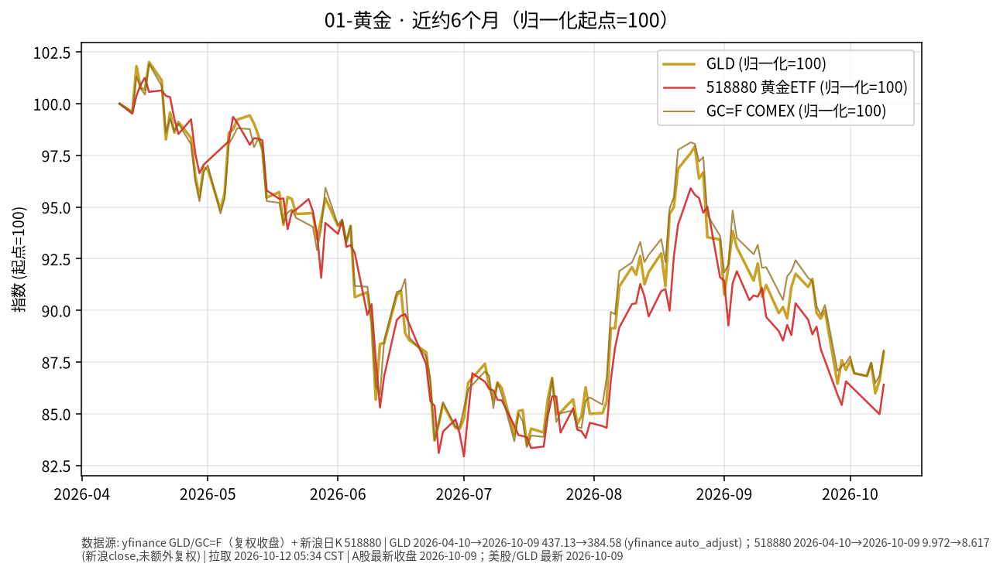

# 黄金日报 · 2026-10-12

> 日历说明：报告日为 **2026-10-12（周一，Asia/Shanghai）清晨约 05:30**。A股国庆休市为 10/1–10/7，**10/8 起照常开市**；**2026-10-10 为周六**（非交易日）。本报告撰写时 A股当日尚未开盘，**国内相关收盘价取 2026-10-09（周五）**。美股/GLD 取 **2026-10-09** 收盘（周末及周一美股哥伦布日休市安排以交易所公告为准，本稿不引用未公布收盘）。

## 1. 市场状态

- 海外现货金价在 10/9（周五）延续反弹：公开报道现货收于约 **4194～4199 美元/盎司**量级（当日约 **+1.5%**），盘中一度试探 **4200** 上方后回落；COMEX 黄金期货（GC=F）当日收于约 **4216**。
- ETF 口径：**GLD** 10/9 收盘 **384.58**，较前一交易日 **378.62** 上涨约 **+1.57%**，为近一周相对强势一日。
- 在岸代理：华安黄金 ETF **518880** 10/9 收盘 **8.617**，较 10/8 的 **8.474** 约 **+1.69%**；上金所 Au99.99 10/9 收盘约 **904.48 元/克**（约 +1.40%）。节前 9/30 的 518880 收于 **8.633**，两日合计仍略低于节前。
- 宏观背景（公开报道）：美债 10 年期收益率 10/9 收于约 **5.244%**（较 10/8 的 5.231% 略升约 **1.3 bp**），美元指数约 **102.2**；周中曾因实际利率/美债飙升压制金价，周末前出现逢低买盘与周度录得约三周来首次上涨的公开叙述。高实际利率与强美元仍是描述无息黄金机会成本的主线因素。
- 汇率：USD/CNY（yfinance CNY=X）最新约 **6.683**（10/11 报价），近月人民币相对美元略有升值倾向，在岸黄金与美元金价可能出现短期偏离。

## 2. 关键数据

| 标的 | 最新交易日 | 收盘 | 日变动 | 近约1个月 | 近约6个月（自约2026-04-10） |
|------|------------|------|--------|-----------|------------------------------|
| GLD（yfinance, auto_adjust） | 2026-10-09 | **384.58** | **+1.57%** | 约 **-3.8%** | 约 **-12.0%** |
| 518880 黄金ETF（新浪日K close） | 2026-10-09 | **8.617** | **+1.69%** | 约 **-4.5%** | 约 **-13.6%** |
| 上金所 Au99.99（官网日行情） | 2026-10-09 | **904.48** 元/克 | **+1.40%** | 约 **-4.8%** | 约 **-13.6%** |
| 美债10Y ^TNX（yfinance） | 2026-10-09 | **5.244%** | 约 **+1.3 bp** | 水平抬升 | 自约4.3%升至5.24%量级 |

图表为 GLD 与 518880 归一化至 start=100 的可比走势（见上图）。

## 3. 简要解读

- 近半年黄金 ETF/现货价格自 4 月高位回撤仍明显：GLD、518880 与上金所现货轨迹高度同步，反映**利率/美元主导**的定价环境。
- 10/9 海外与在岸同步反弹，扭转周中回撤的一部分；但月度与半年维度仍处回撤区间，单日反弹不改变半年回撤事实。
- 本文只描述价格与利率如何共同变化，不评价是否应增减仓。

## 4. 关注点与风险

- **美债实际利率与美元**：若收益率再度逼近近期高点，对黄金的机会成本压力可能再现；市场公开关注后续美国 CPI 等数据窗口。
- **政策预期**：联储官员表态与加息定价影响“更高更久”路径，属于不确定项。
- **在岸/离岸价差**：518880、上金所与 GLD/现货可能因汇率、交易时段、折溢价出现短期偏离。
- **数据局限**：国内金价另有纸黄金等口径，本报告以 ETF/上金所公开行情为主。

## 5. 来源与时间

- 行情：yfinance（GLD、GC=F、^TNX、CNY=X）；新浪财经日K（518880）；上金所官网日行情（Au99.99）——拉取时间约 **2026-10-12 05:34 CST**。
- 现货与宏观叙述：Kitco / Mitrade / 公开财经报道关于 10/9 金价与美债收益率（约 4194～4200 美元、周度约 +1%～1.5%）。
- A股休市安排：上交所 2026 年中秋/国庆休市公告（10/1–10/7 休市，10/8 起开市；10/10 为周六周末休市）。
- 声明：事实梳理，**非投资建议**。
