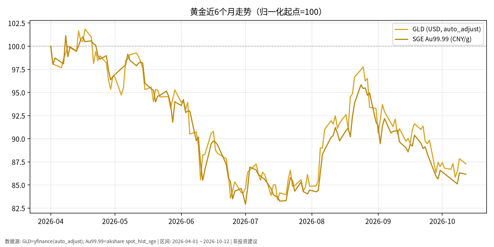

# 黄金日报 · 2026-10-13

> 日历日：2026-10-13（周二）为 **A 股交易日**；本篇关键报价与走势截至 **2026-10-12 收盘（写稿时点为 10-13 盘前，当日 A 股尚未开盘/收盘）**。  
> 原则：只描述市场如何变化，不构成买卖或加仓建议。

## 市场状态

- 近约 6 个月窗口内，黄金相关价格整体自高位回落：美股黄金 ETF **GLD** 自 2026-04-01 至 2026-10-12 收盘约 **-12.7%**；国内上海金 **Au99.99** 同期约 **-13.8%**。
- 路径特征：4–5 月高位后 6–7 月明显下行，8 月一度反弹接近起点，9 月起再次回落；国庆后首个交易周（10-08 起）出现小幅反弹，但 10-12 较 10-09 略回吐。
- 美元计价（GLD）与人民币计价现货（Au99.99）走势高度相关，归一化后近期 GLD 略强于国内现货。

## 关键数据

| 标的 | 最新收盘 | 较上一交易日 | 近6个月（窗口起点→终点） | 数据截止 |
|------|----------|--------------|--------------------------|----------|
| GLD（USD） | 382.15 | 约 -0.63%（相对 10-09） | 437.82 → 382.15（约 -12.72%） | 2026-10-12 |
| SGE Au99.99（元/克） | 902.90 | 约 -0.17%（相对 10-09） | 1047.89 → 902.90（约 -13.84%） | 2026-10-12 |
| 国庆后（10-08→10-12）GLD | — | — | 378.62 → 382.15（约 +0.93%） | — |
| 国庆后（10-08→10-12）Au99.99 | — | — | 892.00 → 902.90（约 +1.22%） | — |

说明：美股 10-10（周五）至 10-12（周一）之间无 10-11/10-12 周末；GLD 上一有效交易日为 10-09，故日变动按 10-09→10-12 计算。国内金 10-09→10-12 同理（10-10 休市日历以交易日历为准）。

## 简要解读

- **价格层面**：当前点位仍明显低于 4 月初窗口起点；近一周在国庆假期后有修复，但幅度有限，尚未扭转近 6 个月下行的大区间位置。
- **价格路径**：波动主要体现为“下行—反弹—再下行”的波段，而非单边趋势；人民币与美元计价序列方向一致，差异更多来自汇率与本地供需微观结构。
- **与利率环境的事实对照**：同期美国 10Y 国债收益率近期披露值约在 **5.2%–5.3%** 一带（akshare 债券收益率表，最新有效约 2026-10-09 的 5.24%）；名义利率偏高的环境中，无息资产（黄金）的机会成本通常更高——此为常见宏观关联描述，**不是**对后市方向的判断。

## 关注点与风险

- **数据时效**：本篇为盘前写稿，10-13 当日国内外金价/GLD 收盘尚未形成；若需盘后更新，应以当日收盘为准。
- **汇率与计价**：GLD 为美元资产，境内投资者还需考虑换汇、渠道与合规约束；Au99.99 为境内人民币计价现货参考。
- **波动与流动性**：黄金短期波幅显著大于中短债/利率债 ETF；任何配置比例变化应由本人根据流动性需求与回撤承受自行判断。
- **不编造未公布数据**：未引用未披露的官方库存或未证实的央行购金传闻。

## 来源与时间

- GLD 日K：yfinance（`auto_adjust=True`）
- Au99.99：akshare `spot_hist_sge`
- 美债 10Y 辅助：akshare `bond_zh_us_rate`
- 绘图区间：2026-04-01 ~ 2026-10-12；写稿时间：2026-10-13 05:45 Asia/Shanghai (CST, UTC+8)
- 图表文件：`./charts/黄金-6m.png`（同源副本 `01-黄金.png`）
