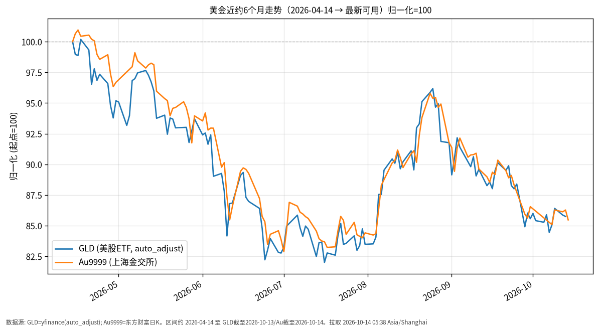

# 黄金日报 · 2026-10-14（周三）

## 1. 市场状态
- 报告撰写于 Asia/Shanghai 凌晨，美股/A股当日尚未形成新收盘；**ETF/股票类数据截至上一交易日**。
- 国际现货黄金近两周大致在约 4,100–4,200 美元/盎司区间震荡；市场在等待本周（含今日）美国 CPI 等通胀数据，美元与美债收益率仍是主要压制/支撑变量。
- GLD（美股黄金ETF）与上海 Au9999 近6个月整体自高位回落，路径高度相关。

## 2. 关键数据
| 标的 | 最新价 | 日涨跌 | 近约6个月（自 2026-04-14） | 数据截至 |
|------|--------|--------|-------------------------|----------|
| GLD | 381.67 美元 | -0.13% | -14.25%（445.09→381.67） | 2026-10-13 |
| Au9999 | 896.00 元/克 | -0.93% | -14.53%（1048.35→896.00） | 2026-10-14 |

- GLD：近约6个月前复权/自动复权收盘自约 445.09 降至 381.67，累计约 -14.25%。
- Au9999：区间内自约 1048.35 至 896.00，累计约 -14.53%；金交所可有早盘/当日条，故截至日可与美股差一天。
- 公开报道显示现货金价近日在约 4,160 美元附近波动（不同终端报价略有差异），属事实参考，非交易建议。

## 3. 简要解读
- **事实路径**：自 2026-04 中旬起，GLD 与 Au9999 同步下行，年中一度靠近归一化约 82–85 区域，8–9 月有过反弹，此后再度回落；两条线高度同步，说明境内外金价主驱动仍是美元计价金价。
- **当日/近期背景**：美元偏强、美债收益率仍处相对高位，限制金价上破动能；同时地缘与央行购金等因素仍提供需求侧讨论。今日关注美国 CPI 公布后的波动，而非预设方向。

## 4. 关注点与风险
- 美国通胀数据与美联储路径预期变化，会通过实际利率与美元传导至金价。
- 境内外价差、汇率与交易时段差异，导致 GLD 与 Au9999 日内不完全同步。
- 黄金波动显著高于中短债/国债类工具；本日报只描述已发生价格路径，不构成买卖或加仓建议。

## 5. 来源与时间
- GLD：yfinance（auto_adjust=True）日线
- Au9999：东方财富公开日K（secid=118.AU9999）
- 宏观背景参考：公开财经报道（现货金、美元、美债收益率、CPI 预期）
- 拉取时间：2026-10-14 05:38 Asia/Shanghai
- **数据截至**：GLD 2026-10-13；Au9999 2026-10-14（A 股相关门类统一按 2026-10-13）

## 6. 近6个月走势图

