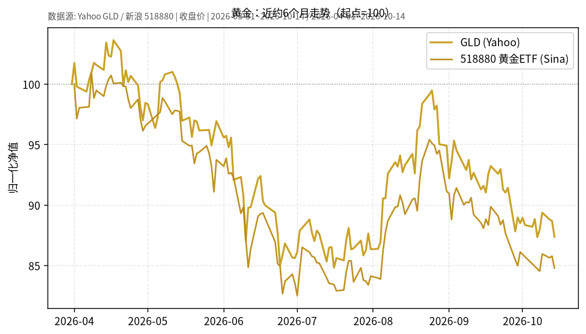

# 黄金日报 2026-10-15

> 日历日：2026-10-15（周四）。报告生成于开盘前（约 05:30 Asia/Shanghai），A 股/国内金 ETF 当日尚未开盘；行情与图表截至**上一交易日 2026-10-14** 收盘。美股 GLD 亦截至 2026-10-14。

## 市场状态

黄金相关标的在近约 6 个月窗口内整体走弱：国际金 ETF（GLD）与国内华安黄金 ETF（518880）均自 4 月初附近高位回落，期间 6–7 月出现较深回撤，8 月一度反弹，9 月后再度下行。上一交易日（10-14）两者同步走低。

## 关键数据

| 标的 | 数据日 | 收盘 | 较前一交易日 | 窗口起点→终点涨跌 |
|------|--------|------|--------------|-------------------|
| GLD（Yahoo） | 2026-10-14 | 375.99 | **-1.49%**（前收 381.67） | 2026-03-31→10-14：**约 -12.6%** |
| 518880 黄金 ETF（新浪） | 2026-10-14 | 8.501 | **-1.14%**（前收 8.599） | 2026-04-01→10-14：**约 -15.2%** |

图表为多序列归一化（起点=100），便于对比路径，不代表绝对价格水平。

## 简要解读

- 近 6 个月路径显示：金价（以 GLD / 518880 收盘价代理）自春季高位回落后，波动加大；10-14 单日跌幅约 1.1%–1.5%。
- 国内外代理高度联动，但幅度不完全一致（汇率、交易时段、费用与跟踪误差均可造成差异）。
- 本报告只描述已发生的价格变化，不推断后续方向。

## 关注点与风险

- **波动路径**：近半年回撤幅度不小，黄金价格波动仍可能显著大于中短债/利率债 ETF。
- **数据口径**：新浪日 K 为收盘价序列；GLD 来自 Yahoo 日频收盘。跨市场时差与假期可能导致单日不完全对齐。
- **汇率与流动性**：境内金 ETF 与美元计价金价之间存在人民币汇率传导；大额交易时需注意折溢价与成交量。

## 来源与时间

- GLD：Yahoo Finance chart API（日频收盘）
- 518880：新浪财经日 K（`CN_MarketData.getKLineData`）
- 图表区间：约 2026-04-01（GLD 自 2026-03-31）至 2026-10-14
- 整理时间：2026-10-15 约 05:30–06:00 Asia/Shanghai
