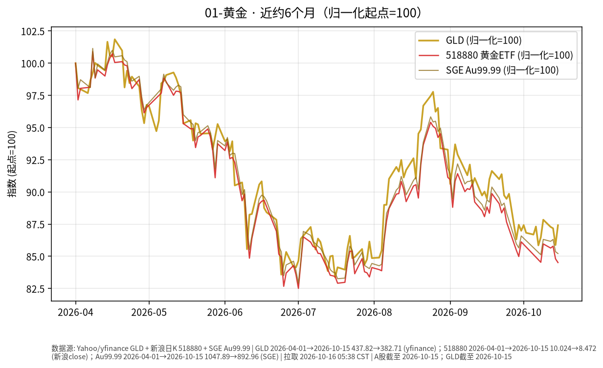

# 黄金日报 2026-10-16

> 日历日：2026-10-16（周五）。报告生成于开盘前（约 05:30 Asia/Shanghai），A 股/国内金 ETF 当日尚未开盘；行情与图表截至**上一交易日 2026-10-15** 收盘。美股 GLD 亦截至 2026-10-15。

## 市场状态

黄金相关标的在近约 6 个月窗口内整体走弱：国际金 ETF（GLD）与国内华安黄金 ETF（518880）均自 4 月初附近高位回落；上海金交所 Au99.99 路径方向相近。上一交易日（10-15）GLD 收涨，518880 与 Au99.99 小幅收跌，国内外代理单日方向未完全同步。

## 关键数据

| 标的 | 数据日 | 收盘 | 较前一交易日 | 窗口起点→终点涨跌 |
|------|--------|------|--------------|-------------------|
| GLD（Yahoo） | 2026-10-15 | 382.71 | **+1.79%**（前收 375.99） | 2026-04-01→10-15：**约 -12.6%** |
| 518880 黄金 ETF（新浪） | 2026-10-15 | 8.472 | **-0.34%**（前收 8.501） | 2026-04-01→10-15：**约 -15.5%** |
| SGE Au99.99 | 2026-10-15 | 892.96 | **-0.17%**（前收 894.50） | 2026-04-01→10-15：**约 -14.8%** |

图表为多序列归一化（起点=100），便于对比路径，不代表绝对价格水平。

## 简要解读

- 近 6 个月路径显示：金价（以 GLD / 518880 / Au99.99 收盘价代理）自春季高位回落，波动明显大于债券类 ETF。
- 10-15 单日：美元计价 GLD 反弹约 1.8%，境内 518880 与现货 Au99.99 略跌；跨市场时差、汇率与跟踪误差均可造成单日不完全对齐。
- 本报告只描述已发生的价格变化，不推断后续方向。

## 关注点与风险

- **波动路径**：近半年回撤幅度不小，黄金价格波动仍可能显著大于中短债/利率债 ETF。
- **数据口径**：新浪日 K 为收盘价序列；GLD 来自 Yahoo/yfinance 日频收盘；Au99.99 来自上海金交所公开日行情。
- **汇率与流动性**：境内金 ETF 与美元计价金价之间存在人民币汇率传导；大额交易时需注意折溢价与成交量。

## 来源与时间

- GLD：Yahoo Finance / yfinance（日频收盘）
- 518880：新浪财经日 K（`CN_MarketData.getKLineData`）
- Au99.99：上海黄金交易所公开日行情接口
- 图表区间：约 2026-04-01 至 2026-10-15
- 整理时间：2026-10-16 约 05:30–06:00 Asia/Shanghai
