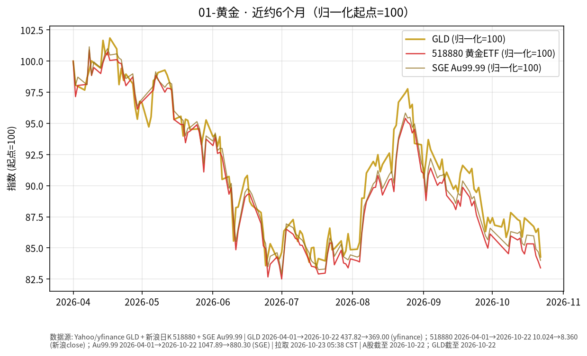

# 黄金 · 日报 2026-10-23

## 市场状态
- **报告日**：2026-10-23（周五，Asia/Shanghai）
- **数据截止交易日**：美股/GLD **2026-10-22**；A 股当日早盘未收盘，境内相关用上一交易日收盘。
- GLD 收盘 **369.00**，较前一交易日 **-2.63%**（Yahoo Finance，复权收盘）。
- 沪金 AU9999：**2026-10-22** 收盘 **880.30** 元/克（**-0.811%**）；黄金 ETF 518880 收 **8.360**（**-0.618%**）。

## 关键数据
| 标的 | 最近收盘日 | 收盘 | 日涨跌 | 近约6个月（归一起点日） | 区间涨跌 |
|------|------------|------|--------|-------------------------|----------|
| GLD | 2026-10-22 | 369.00 | -2.63% | 2026-04-22→2026-10-22 | -15.22% |
| 518880 黄金ETF | 2026-10-22 | 8.360 | -0.618% | 2026-04-22→2026-10-22 | -16.43% |
| AU9999（沪金） | 2026-10-22 | 880.30 | -0.811% | 2026-04-22→2026-10-22 | -16.09% |

## 简要解读
- 美元计价黄金 ETF（GLD）在 **2026-10-22** 明显回落（约 **-2.63%**），与境内 518880、沪金 AU9999 同日下行方向一致；近约半年归一后约 **-15.2%～-16.4%**。
- 价格变动同时受美元、实际利率与风险情绪影响；本页只描述已发生报价，不推断下一步方向。

## 关注点与风险
- 汇率：境内投资者若以人民币计量，还需叠加美元兑人民币变动，账面涨跌可能与 GLD 美元涨跌不一致。
- 波动：黄金阶段性回撤后波动仍可能放大；ETF 净值/溢价、交易时段与现货不完全同步。
- 数据完整性：本次成功叠加 GLD、518880 与 SGE Au99.99 三条归一曲线。

## 来源与时间
- GLD：Yahoo Finance（yfinance，auto_adjust=True），拉取时间约 2026-10-23 05:41:05 Asia/Shanghai
- 518880：新浪日 K；AU9999：上海金交所 Dailyhq
- 图表：Python matplotlib，收盘价归一到起点=100（图窗自 2026-04-01 起）
