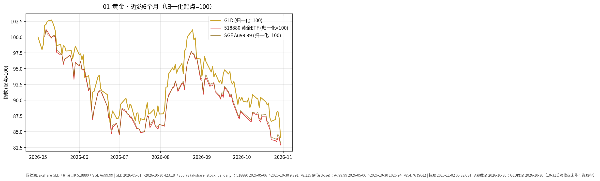

# 黄金 · 日报 2026-11-02

## 市场状态
- **报告日**：2026-11-02（周一，Asia/Shanghai 盘前例程）
- **数据截止交易日**：A 股/沪金/GLD 均为 **2026-10-30（周四）**。按新浪 A 股交易日历，**2026-10-31（周五）非交易日**（10-30 后下一开市日为 11-02）；本页数字不含周一盘中。**2026-11-02 为开市日**。
- GLD 收盘 **355.78**，较前一交易日（10-29 的 368.57）**-3.47%**（akshare 日 K；yfinance/Yahoo 当日限流；未能可靠取得 10-31 美股收盘，故 GLD 截止写 10-30）。
- 沪金 AU9999：**2026-10-30** 收盘 **854.76** 元/克（**-1.21%**）；黄金 ETF 518880 收 **8.115**（**-1.33%**）。

## 关键数据
| 标的 | 最近收盘日 | 收盘 | 日涨跌 | 近约6个月（归一起点日） | 区间涨跌 |
|------|------------|------|--------|-------------------------|----------|
| GLD | 2026-10-30 | 355.78 | -3.47% | 2026-05-01→2026-10-30 | -15.93% |
| 518880 黄金ETF | 2026-10-30 | 8.115 | -1.33% | 2026-05-06→2026-10-30 | -17.12% |
| AU9999（沪金） | 2026-10-30 | 854.76 | -1.21% | 2026-05-06→2026-10-30 | -16.77% |

## 简要解读
- 美元计价黄金 ETF（GLD）在 **2026-10-30** 明显回落（约 **-3.47%**）；境内 518880 约 **-1.33%**，沪金 AU9999 约 **-1.21%**。近约半年归一后约 **-15.93%～-17.12%**。
- 价格变动同时受美元、实际利率与风险情绪影响；本页只描述已发生报价，不推断下一步方向。

## 关注点与风险
- 汇率：境内投资者若以人民币计量，还需叠加美元兑人民币变动，账面涨跌可能与 GLD 美元涨跌不一致。
- 波动：黄金阶段性回撤后波动仍可能放大；ETF 净值/溢价、交易时段与现货不完全同步。
- 数据完整性：GLD 来自 akshare（至 2026-10-30）；10-31 美股收盘未能从公开源可靠取得。518880 新浪日 K；SGE Au99.99 完整。图中三条归一曲线均已叠加。A 股 10-31 按日历休市。

## 来源与时间
- GLD：akshare `stock_us_daily`（至 2026-10-30）；yfinance/Yahoo 限流
- 518880：新浪日 K；AU9999：上海金交所 Dailyhq
- 图表：Python matplotlib，收盘价归一到起点=100（图窗自 2026-05-01 起）；拉取约 2026-11-02 05:32 Asia/Shanghai
