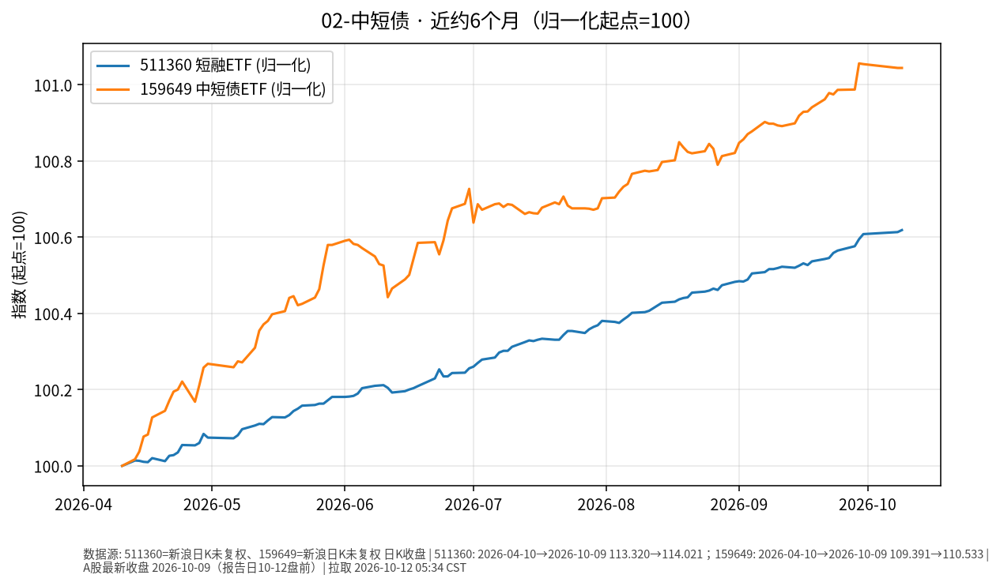

# 中短债日报 · 2026-10-12

> 日历说明：报告日 **2026-10-12（周一）清晨 CST**；A股 **10/8、10/9 已开市**（国庆 10/1–10/7 休市；**10/10 为周六**），当日盘前报告取 **2026-10-09** 收盘为最新。

## 1. 市场状态

- 10/9（周五）短端利率债 ETF 价格波动仍极小：中证短融 ETF **511360** 微升；深市中短债 **159649** 持平。
- 银行间债市（新华财经《债市日报：10月9日》）：利率债收益率回落约 **0.5 bp** 量级；公开市场单日净回笼约 **6040 亿元**，但 Shibor 短端多数下行（隔夜约 **1.313%**，公开报道称创 2026 年 5 月以来新低）——资金价格转松与短久期券价“窄幅整理”并存。
- 近半年维度：短融/中短债 ETF 价格缓升，波动显著小于权益与黄金。

## 2. 关键数据

| 标的 | 最新交易日 | 收盘 | 日变动 | 相对9/30（节前） | 近约6个月（自约2026-04-10） |
|------|------------|------|--------|------------------|------------------------------|
| **511360** 海富通中证短融ETF | 2026-10-09 | **114.021** | **+0.005%** | **+0.011%** | 约 **+0.62%** |
| **159649** 中短债ETF（深市） | 2026-10-09 | **110.533** | **0.00%** | **-0.010%** | 约 **+1.04%** |

（新浪财经日K `close` 字段；图表为 start=100 归一化。）

## 3. 简要解读

- 10/9 短端 ETF 价格变动在 **万分之几或持平** 量级，符合短久期、票息主导的特征。
- 近 6 个月累计价格升幅约 **0.6%～1.0%**（未计入可能分红，需以基金公告为准），路径相对平滑。
- 资金面“大规模逆回购到期 + 短端利率下行”的组合，显示季节性宽松与操作回笼可同时出现；ETF 价格尚未出现大幅回撤。

## 4. 关注点与风险

- **资金利率与公开市场操作**：月中政府债缴款、工具到期等可能带来短端利率脉冲（公开机构观点常见表述）。
- **信用下沉差异**：短融指数成分以高等级短久期信用为主，但仍有信用利差波动风险。
- **净值与交易价**：ETF 二级市场价格可能相对 IOPV 出现短暂折溢价。
- 价格收益 ≠ 含分红总回报；具体分红以基金公司披露为准。

## 5. 来源与时间

- 行情：新浪财经日K —— **2026-10-12 约 05:34 CST** 拉取。
- 债市环境：新华财经《债市日报：10月9日》（银行间收益率、国债期货、资金面、Shibor）。
- 休市安排：上交所 2026 年国庆休市通知。
- 声明：事实梳理，**非投资建议**。
