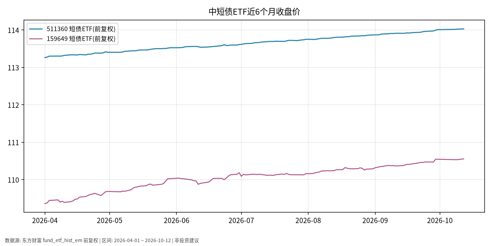

# 中短债日报 · 2026-10-13

> 日历日：2026-10-13（周二）为 **A 股交易日**；本篇关键报价截至 **2026-10-12 收盘（写稿时点为 10-13 盘前，当日 A 股尚未开盘/收盘）**。  
> 原则：只描述市场如何变化，不构成买卖或加仓建议。

## 市场状态

- 代表标的 **511360**（短债 ETF）、**159649**（短债 ETF）近 6 个月收盘价呈缓慢上行、日波动极小的路径。
- 国庆长假后复市以来（10-08 至 10-12），511360 累计变动约 **+0.01%** 量级，价格几乎沿水平线爬升。
- 相对权益与黄金，中短债 ETF 近半年来价格路径更平滑，反映短久期利率品种对利率与利差变化的敏感度通常低于长久期品种（事实描述，非收益承诺）。

## 关键数据

| 标的 | 最新收盘 | 日涨跌幅（10-12） | 近6个月 | 数据截止 |
|------|----------|-------------------|---------|----------|
| 511360 | 114.028 | +0.01% | 113.263 → 114.028（约 **+0.68%**） | 2026-10-12 |
| 159649 | 110.554 | +0.02% | 109.361 → 110.554（约 **+1.09%**） | 2026-10-12 |
| 511360 国庆后 10-08→10-12 | — | — | 114.015 → 114.028（约 +0.01%） | — |

## 简要解读

- **价格变化**：两只短债 ETF 在观察窗口内均为小幅正变动；日涨跌幅多在 0.00%–0.02% 量级，符合短久期、低波动品种的历史路径特征。
- **与“收益率数字”的区别**：ETF 二级市场价格变动 ≠ 基金合同披露的七日年化或业绩比较基准；后者需以基金公司最新公告为准，本篇未引用未核对的宣传口径。
- **路径清晰度**：近 6 个月曲线接近缓升直线，回撤在图上不显著；这描述的是**已实现价格路径**，不保证未来同样平滑。

## 关注点与风险

- **利率与流动性环境变化**：若短端资金利率或信用利差波动加大，短债 ETF 也可能出现超出近期日波幅的回撤（历史曾有过净值波动放大阶段，需以实际净值为准）。
- **溢价/折价与流动性**：交易价格相对 IOPV 可能存在小幅偏离；成交额与冲击成本因时点而异。
- **税费与持有体验**：场内交易有佣金；分红与复权方式会影响“裸价”观感——本图 511360/159649 采用东财**前复权**序列。
- **当日未收盘**：10-13 盘前写稿，最终以当日收盘与净值为准。

## 来源与时间

- 511360、159649：东方财富/akshare `fund_etf_hist_em`，**前复权**
- 绘图区间：2026-04-01 ~ 2026-10-12；写稿时间：2026-10-13 05:45 Asia/Shanghai (CST, UTC+8)
- 图表：`./charts/中短债-6m.png`
