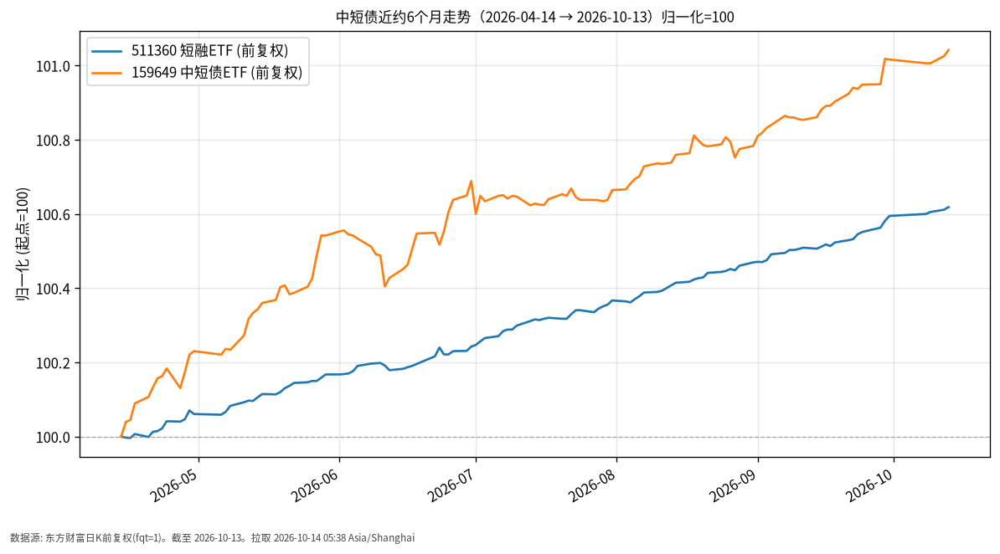

# 中短债日报 · 2026-10-14（周三）

## 1. 市场状态
- 撰写于周三凌晨，**A 股债券 ETF 数据截至上一交易日 2026-10-13**（当日尚未开盘/收盘）。
- 短端利率债与中短久期信用/利率仓位整体波动远小于权益；近6个月两条跟踪标的均为缓慢抬升的价格路径。
- 银行间资金面近日报道为平稳偏松，短端 Shibor 有所下行（公开报道，供背景）。

## 2. 关键数据
| 标的 | 最新价 | 日涨跌 | 近约6个月（自 2026-04-14） | 数据截至 |
|------|--------|--------|-------------------------|----------|
| 511360 短融ETF | 114.036 | +0.01% | +0.62%（113.335→114.036） | 2026-10-13 |
| 159649 中短债ETF | 110.572 | +0.02% | +1.04%（109.432→110.572） | 2026-10-13 |

- 两者近6个月累计涨幅约在 +0.62%～+1.04% 量级，日度波动多为几个 bp 量级的价格变化。
- 价格为东方财富前复权日K收盘，便于跨区间比较；实际持有收益仍取决于申赎、折溢价与费用。

## 3. 简要解读
- **事实路径**：归一化图上两条线自起点 100 缓升，斜率平缓，符合短久期利率/中短债「低波动累积」特征。
- 2026-10-13 两只 ETF 均小幅收涨，与当日债市偏强、资金面偏松的公开描述一致。
- 本门类强调路径可见性，不讨论是否加仓或拉长久期。

## 4. 关注点与风险
- 资金面季节性收紧、公开市场操作量变化，可能抬升短端波动。
- ETF 二级市场价格相对 IOPV 的折溢价、流动性在极端日可能放大。
- 信用下沉或久期上移会改变风险形态；当前标的为中短端工具，仍非「无风险」。

## 5. 来源与时间
- 511360 / 159649：东方财富公开日K，前复权（fqt=1）
- 资金面背景：公开财经报道（财联社等，2026-10-13 债市收盘综述）
- 拉取时间：2026-10-14 05:38 Asia/Shanghai
- **数据截至**：2026-10-13

## 6. 近6个月走势图

