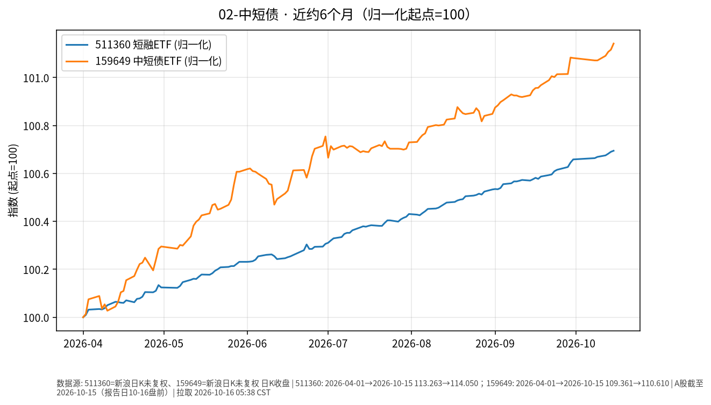

# 中短债日报 2026-10-16

> 日历日：2026-10-16（周五）。开盘前报告；行情与图表截至**上一交易日 2026-10-15**。

## 市场状态

中短债/短融相关 ETF 近约 6 个月呈现小幅上行、波动极低的路径。上一交易日（10-15）511360、159649 均接近平盘微涨。

## 关键数据

| 标的 | 数据日 | 收盘 | 较前一交易日 | 窗口起点→终点涨跌 |
|------|--------|------|--------------|-------------------|
| 511360（短融 ETF） | 2026-10-15 | 114.050 | **+0.004%**（前收 114.045） | 2026-04-01→10-15：**约 +0.69%** |
| 159649（中短债） | 2026-10-15 | 110.610 | **+0.025%**（前收 110.582） | 2026-04-01→10-15：**约 +1.14%** |

图表归一化起点=100。

## 简要解读

- 相对权益与黄金，这两只标的近半年价格路径更平缓，单日变动通常在几个基点量级。
- 10-15 两者几乎同步、幅度极小，符合短久期利率品种常见的低波动特征。
- 价格涨跌不等于「票息到手」：ETF 净值还受持仓估值、费用、折溢价等影响。

## 关注点与风险

- **利率环境变化**：若短端利率或资金面波动加大，净值仍可能出现小幅回撤（幅度通常小于长久期品种，但不为零）。
- **折溢价与流动性**：场内成交活跃度变化时，买卖价差可能扩大。
- **数据口径**：新浪日 K 收盘价；未做额外复权处理（债券 ETF 拆分较少，路径仍可参考）。

## 来源与时间

- 新浪财经日 K：511360、159649
- 图表区间：2026-04-01 → 2026-10-15
- 整理时间：2026-10-16 约 05:30–06:00 Asia/Shanghai
