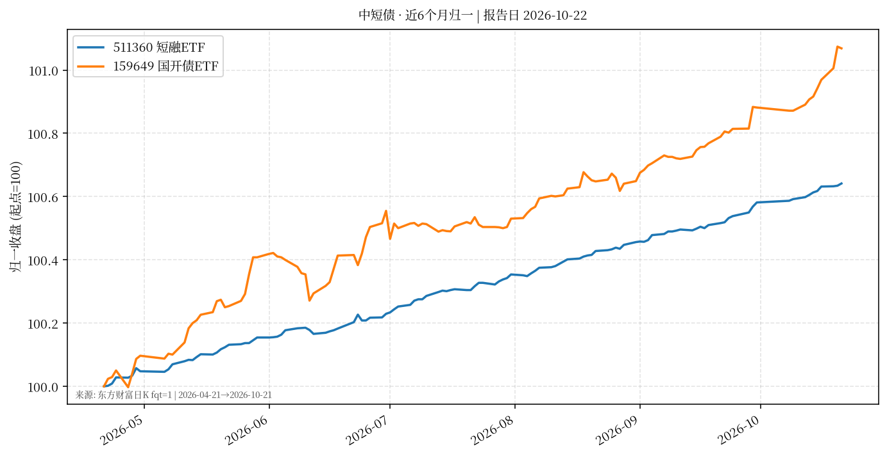

# 中短债 · 日报 2026-10-22

## 市场状态
- **报告日**：2026-10-22；**A 股数据截止交易日**：**2026-10-21**（周四早间报告，当日未收盘）。
- 短融 ETF 511360 收 **114.077**（日涨跌 **+0.007%**）。
- 159649（国开债 ETF 华安）收 **110.749**（日涨跌 **-0.005%**）。
- 公开债市报道（新华财经 2026-10-21）：银行间利率债收益率多数小幅回升；短端资金利率仍偏松。仅作背景，非交易建议。

## 关键数据
| 标的 | 收盘日 | 收盘 | 日涨跌 | 约6个月区间 | 区间涨跌 |
|------|--------|------|--------|-------------|----------|
| 511360 短融ETF海富通 | 2026-10-21 | 114.077 | +0.007% | 2026-04-21→2026-10-21 | +0.64% |
| 159649 国开债ETF华安 | 2026-10-21 | 110.749 | -0.005% | 2026-04-21→2026-10-21 | +1.07% |

## 简要解读
- 两条曲线近半年均呈缓慢抬升（归一后约 **+0.64%** / **+1.07%**），单日波动极小，符合短久期利率品种特征。
- 159649 跟踪国开债，久期与信用暴露通常高于纯短融；与 511360 并排只为对照路径，不暗示优劣。

## 关注点与风险
- 利率上行时净值可能回撤（即使票息仍为正）。
- ETF 折溢价、流动性与跟踪误差；节假日后跳空可能出现。
- 杠杆与加久期会放大波动——本报告不讨论、不鼓励此类操作。

## 来源与时间
- 东方财富 push2his 日 K（klt=101，fqt=1 前复权），截止 2026-10-21
- 债市背景：新华财经《债市日报：10月21日》、中债收益率曲线公开页
- 图表：matplotlib，起点归一=100
