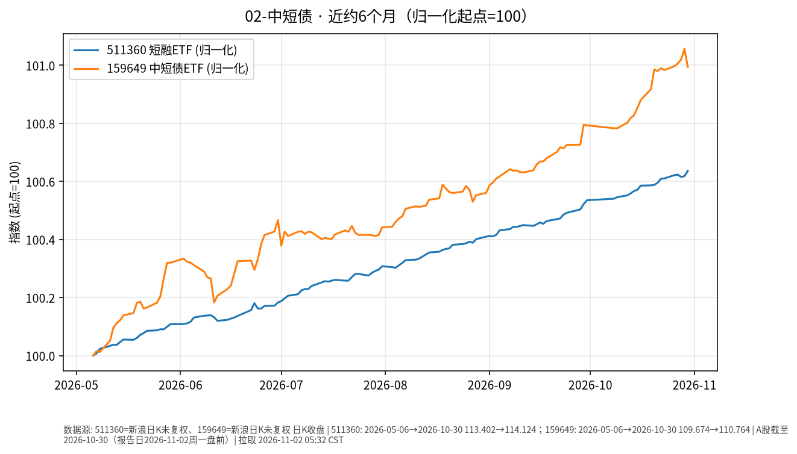

# 中短债 · 日报 2026-11-02

## 市场状态
- **报告日**：2026-11-02；**A 股数据截止交易日**：**2026-10-30**（周一盘前；10-31 按新浪交易日历非 A 股交易日）。交易日历：**2026-11-02 为开市日**。
- 短融 ETF 511360 收 **114.124**（日涨跌 **+0.018%**）。
- 159649（国开债 ETF 华安）收 **110.764**（日涨跌 **-0.062%**）。
- 短端品种单日变动极小；仅作路径对照，非交易建议。

## 关键数据
| 标的 | 收盘日 | 收盘 | 日涨跌 | 约6个月区间 | 区间涨跌 |
|------|--------|------|--------|-------------|----------|
| 511360 短融ETF海富通 | 2026-10-30 | 114.124 | +0.018% | 2026-05-06→2026-10-30 | +0.64% |
| 159649 国开债ETF华安 | 2026-10-30 | 110.764 | -0.062% | 2026-05-06→2026-10-30 | +0.99% |

## 简要解读
- 两条曲线近半年均呈缓慢抬升（归一后约 **+0.64%** / **+0.99%**），单日波动接近于零，符合短久期利率品种特征。
- 159649 跟踪国开债，久期与信用暴露通常高于纯短融；与 511360 并排只为对照路径，不暗示优劣。

## 关注点与风险
- 利率上行时净值可能回撤（即使票息仍为正）。
- ETF 折溢价、流动性与跟踪误差；节假日后跳空可能出现。
- 杠杆与加久期会放大波动——本报告不讨论、不鼓励此类操作。

## 来源与时间
- 新浪 CN_MarketData 日 K，截止 2026-10-30
- 图表：matplotlib，起点归一=100；拉取约 2026-11-02 05:32 Asia/Shanghai
