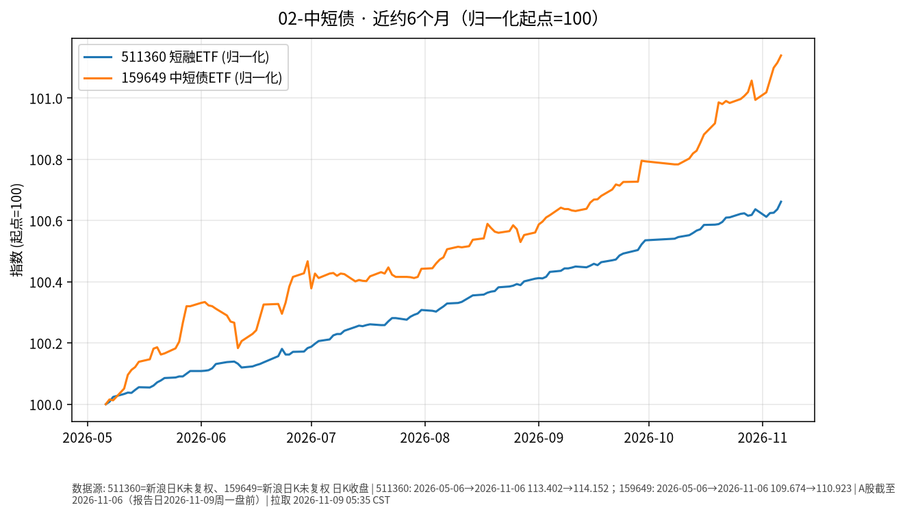

# 中短债 · 日报 2026-11-09

## 市场状态
- **报告日**：2026-11-09（周一盘前）；**A 股数据截止交易日**：**2026-11-06**（周五）。周末休市，今日尚未开盘；本页数字不含周一盘中。
- 短融 ETF 511360 收 **114.152**（日涨跌 **+0.025%**）。
- 159649（国开债 ETF 华安）收 **110.923**（日涨跌 **+0.023%**）。
- 短端品种单日变动极小；仅作路径对照，非交易建议。

## 关键数据
| 标的 | 收盘日 | 收盘 | 日涨跌 | 约6个月区间 | 区间涨跌 |
|------|--------|------|--------|-------------|----------|
| 511360 短融ETF海富通 | 2026-11-06 | 114.152 | +0.025% | 2026-05-06→2026-11-06 | +0.66% |
| 159649 国开债ETF华安 | 2026-11-06 | 110.923 | +0.023% | 2026-05-06→2026-11-06 | +1.14% |

## 简要解读
- 两条曲线近半年均呈缓慢抬升（归一后约 **+0.66%** / **+1.14%**），单日波动接近于零，符合短久期利率品种特征。
- 159649 跟踪国开债，久期与信用暴露通常高于纯短融；与 511360 并排只为对照路径，不暗示优劣。

## 关注点与风险
- 利率上行时净值可能回撤（即使票息仍为正）。
- ETF 折溢价、流动性与跟踪误差；节假日后跳空可能出现。
- 杠杆与加久期会放大波动——本报告不讨论、不鼓励此类操作。

## 来源与时间
- 新浪 CN_MarketData 日 K，截止 2026-11-06
- 图表：matplotlib，起点归一=100；拉取约 2026-11-09 05:35:44 CST

## 今日一点
# 今日一点 · Day 11/100 · 《单位净值、估值日、T+N》

**结论：** 看债基或货基，单位净值是「每一份今天值多少」；按哪天成交、钱何时能用，取决于估值日和 T+N，屏幕数字不是落袋现金。

**机制：** 基金公司在每个交易日收盘后算出当天单位净值，这一天就是估值日；你在规定时点前申购或赎回，才锁定哪天净值。货基常见当日或次日可用，债基赎回多为 T+1 或 T+2 到账；ETF 场内买卖即时成交，和场外申赎不是同一条路径。债底仓票息清晰，要先分清净值更新日和资金可用日——应急金不该压在尚未到账的份额上；以后若划拨股票卫星，A 股卖出也有 T+1 交收，节奏要和动用年限对上。今天只讲结算节奏，不定买卖。
