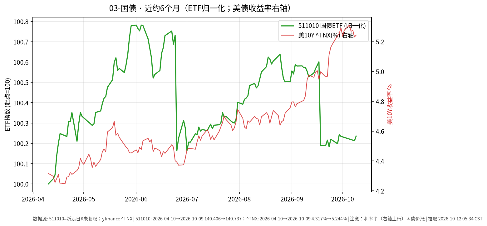

# 国债日报 · 2026-10-12

> 日历说明：报告日 **2026-10-12 清晨 CST**；国内价格取 **2026-10-09**；美债收益率取 **2026-10-09**。**注意：收益率上行对应债券价格承压，图中右轴利率↑并不表示债价上涨。**

## 1. 市场状态

- 国内：国泰上证 5 年期国债 ETF **511010** 10/9 收盘 **140.737**，较 10/8 **140.705** 约 **+0.023%**；相对节前 9/30 **140.735** 基本持平。
- 银行间（新华财经 10/9）：10 年期国债“26附息国债16”收益率下行约 **0.42 bp** 报约 **1.6778%**；中债估值中心日评称中债国债曲线 10 年期稳定在约 **1.69%**。国债期货 10 年期主力约涨 **0.09%**。
- 海外对照：美债 10 年期 ^TNX 10/9 收于约 **5.244%**，较 10/8 的 **5.231%** 略升约 **1.3 bp**；近月仍处多年高位区震荡。
- 内外利率水平差仍大：国内长端利率低位窄幅波动，美债长端高位震荡——分属不同宏观定价体系。

## 2. 关键数据

| 标的 | 最新交易日 | 水平 | 变动 | 近约6个月 |
|------|------------|------|------|-----------|
| **511010** 价格 | 2026-10-09 | **140.737** | +0.023%（相对10/8） | 约 **+0.24%**（自约4/10） |
| 中国 10Y 国债收益率（银行间活跃券/中债曲线，公开债市日报） | 2026-10-09 | 约 **1.68%～1.69%** | 约 **-0.4 bp**（活跃券口径） | — |
| 美债 10Y ^TNX | 2026-10-09 | **5.244%** | 约 **+1.3 bp**（相对10/8） | 自约 4.3% 升至 5.24%量级 |

图表：左轴 511010 价格归一化 start=100；右轴 ^TNX 收益率（%）——**利率轴上升 ≠ 债价上涨**。

## 3. 简要解读

- 511010 近半年价格几乎走平略升（约 +0.2%），体现中短久期利率债在国内低波动环境中的路径。
- 10/9 国内利率小幅下行、ETF 价格微涨，方向一致。
- 美债收益率近半年显著抬升，与黄金回撤同期出现，属跨资产事实关联，不构成操作指令。
- **久期事实**：利率变动对中长久期品种价格影响通常大于短融；此处仅为敏感度描述，非仓位建议。

## 4. 关注点与风险

- **久期**：5 年期国债 ETF 对利率变动敏感度高于短融，但低于超长债。
- **财政与供给**：特别国债/地方债供给节奏可能扰动利率曲线；公开机构观点提到四季度政府债供给节奏或放缓。
- **海外溢出**：美债波动对国内利率的传导不稳定，需分市场观察。
- 期货与现券、ETF 价格可能短期不一致；不同口径（中债曲线 vs 活跃券）收益率数值可能略有差异。

## 5. 来源与时间

- 511010：新浪财经日K；^TNX：yfinance —— **2026-10-12 约 05:34 CST**。
- 国内收益率与期货：新华财经《债市日报：10月9日》；中债估值中心《中债收益率曲线和指数日评2026年10月9日》。
- 声明：事实梳理，**非投资建议**。
