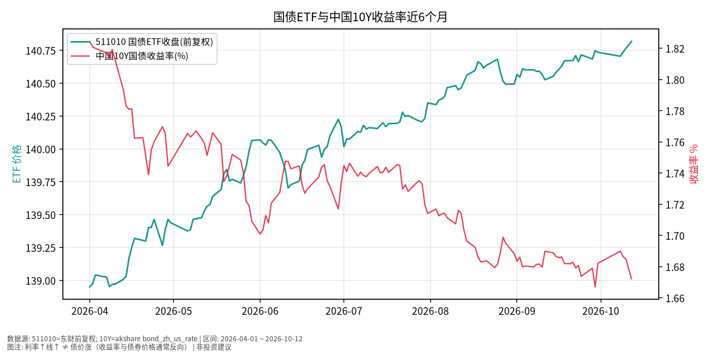

# 国债日报 · 2026-10-13

> 日历日：2026-10-13（周二）为 **A 股交易日**；本篇关键报价截至 **2026-10-12 收盘（写稿时点为 10-13 盘前，当日 A 股尚未开盘/收盘）**。  
> 原则：只描述市场如何变化，不构成买卖或加仓建议。  
> **图注提醒**：利率↑（收益率曲线上移）通常对应债券价格承压；图中收益率轴上行 ≠ 债价上涨。

## 市场状态

- **511010**（国债 ETF）近 6 个月收盘由约 138.95 上行至 **140.818**（约 **+1.34%**），路径总体向上、波动高于短债 ETF 但仍远低于权益。
- **中国国债 10 年期收益率**在同窗口由约 **1.8244%**（2026-04-01）下行至 **1.6722%**（2026-10-12），累计约 **-15.2 bp**；收益率下行与国债 ETF 价格上行在方向上一致（符合久期品种的常见价格—收益率反向关系）。
- 国庆后：10-08 中国 10Y 约 1.6899%，10-12 约 1.6722%（再降约 1.8 bp）；同期 511010 由 140.705 → 140.818（约 +0.08%）。

## 关键数据

| 指标 | 最新 | 变动 | 近6个月 | 截止 |
|------|------|------|---------|------|
| 511010 收盘 | 140.818 | 10-12 日涨跌幅 **+0.06%** | 138.950 → 140.818（约 +1.34%） | 2026-10-12 |
| 中国国债 10Y 收益率 | **1.6722%** | 相对 10-10 的 1.6849% 约 **-1.3 bp** | 1.8244% → 1.6722%（约 -15.2 bp） | 2026-10-12 |
| 中国国债 2Y 收益率 | 1.2631% | 相对 10-10 约 -0.45 bp | — | 2026-10-12 |
| 美国国债 10Y（辅助） | 约 5.24% | 表内最新有效约 2026-10-09 | — | 2026-10-09 |

## 简要解读

- **国内利率路径**：观察期内 10Y 收益率整体下移，511010 价格同步温和上行；这是对**已发生价格与收益率**的描述。
- **中美利差事实**：美国 10Y 仍在约 5.2% 上方（最新有效披露日），中国 10Y 在约 1.67%；跨境配置还涉及汇率、额度与渠道约束，本篇不展开交易路径推荐。
- **久期含义（知识性）**：相对中短债 ETF，国债 ETF 对利率变动通常更敏感；同样幅度的收益率波动，价格波幅往往更大——由图上 511010 相对 511360 的起伏亦可对照观察。

## 关注点与风险

- **利率上行风险**：若未来收益率回升，长久期/利率债价格可能回撤；本篇不预测利率方向。
- **ETF 跟踪与折溢价**：511010 跟踪一篮子国债期货/现货相关组合（以基金合同为准），二级市场可出现折溢价。
- **数据口径**：收益率来自公开中美国债收益率序列；个别节假日美债或国内字段可能为空，已在表中标注最新有效日。
- **10-13 盘前**：当日收盘与盘中收益率以交易所/债券市场实时与收盘数据为准。

## 来源与时间

- 511010：东财/akshare `fund_etf_hist_em`，**前复权**
- 中美国债收益率：akshare `bond_zh_us_rate`
- 绘图区间：2026-04-01 ~ 2026-10-12；写稿时间：2026-10-13 05:45 Asia/Shanghai (CST, UTC+8)
- 图表：`./charts/国债-6m.png`
