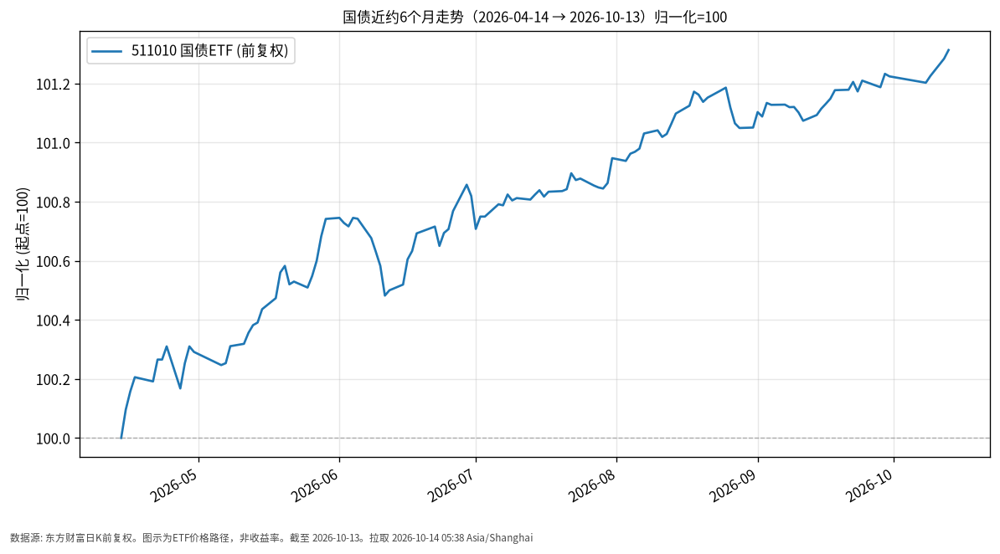

# 国债日报 · 2026-10-14（周三）

## 1. 市场状态
- **数据截至 A 股上一交易日 2026-10-13**（报告日凌晨，当日未收盘）。
- 公开报道：2026-10-13 银行间 10 年期国债活跃券收益率约下行 0.5bp 至约 **1.656%**；国债期货多数收涨，资金面平稳偏松。
- 跟踪标的 511010（国债 ETF）近6个月价格缓升，与收益率下行阶段的债价抬升方向一致（注意：收益率与价格反向）。

## 2. 关键数据
| 标的 | 最新价 | 日涨跌 | 近约6个月（自 2026-04-14） | 数据截至 |
|------|--------|--------|-------------------------|----------|
| 511010 国债ETF | 140.859 | +0.03% | +1.31%（139.033→140.859） | 2026-10-13 |

- 附图仅绘制 ETF 价格归一化路径，**未叠画收益率曲线**；若观察利率，记住「利率↑线↑ ≠ 债价涨」。
- 公开市场：2026-10-13 有等额逆回购到期与投放的公开信息，净回笼/投放以当日央行公告为准。

## 3. 简要解读
- **事实路径**：自 2026-04-14 起 511010 前复权收盘由约 139.033 至 140.859，累计约 +1.31%，波动显著小于权益、大于货币类。
- 2026-10-13 ETF 微涨，与当日长端利率小幅下行、期货偏强的公开事实同向。
- 超长端（如 30 年）公开报道称涨势偏弱，曲线不同部位表现可能分化。

## 4. 关注点与风险
- 本周后续宏观与金融数据、央行操作节奏，可能引发利率阶段性回调或波动加大。
- 久期风险：利率上行时 ETF 净值/价格可能回撤。
- ETF 折溢价与跟踪误差；本日报不建议基于单日 bp 变化做交易决策。

## 5. 来源与时间
- 511010：东方财富公开日K，前复权
- 10Y 国债收益率等：公开债市收盘报道（财联社 2026-10-13）
- 拉取时间：2026-10-14 05:38 Asia/Shanghai
- **数据截至**：2026-10-13

## 6. 近6个月走势图

