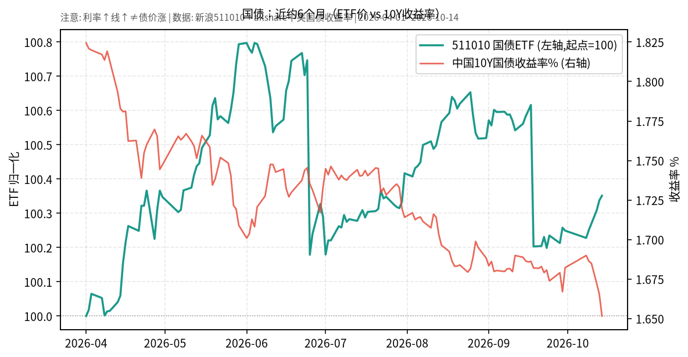

# 国债日报 2026-10-15

> 日历日：2026-10-15（周四）。开盘前报告；ETF 与收益率均截至**上一交易日 2026-10-14**（收益率序列来自 akshare 中美国债收益率表）。

## 市场状态

国债 ETF（511010）近约 6 个月价格略有上行；同期中国 10 年期国债收益率自约 1.82% 附近下行至约 1.65%。**注意：图中收益率曲线上行表示利率上升，通常对应债价承压，不等于债券价格上涨。**

## 关键数据

| 指标/标的 | 数据日 | 读数 | 变化 |
|-----------|--------|------|------|
| 511010 国债 ETF | 2026-10-14 | 收盘 **140.878** | 较前一交易日 **+0.013%**（前收 140.859）；2026-04-01→10-14 约 **+0.35%** |
| 中国 10Y 国债收益率 | 2026-10-14 | **1.6516%** | 较 10-13（1.6654%）约 **-1.4 bp**；较 2026-04-01（1.8244%）约 **-17.3 bp** |
| 美国 10Y 国债收益率 | 2026-10-14 | **5.19%** | 较 10-13（5.21%）约 **-2 bp**（表中 10-10、10-12 等日美债字段有缺失） |

## 简要解读

- 近半年路径上：国内 10Y 收益率总体下行，与国债 ETF 价格小幅上行的方向一致（利率↓ ↔ 债价↑ 的常见对应关系）。
- 10-14 当日：511010 几乎持平微涨；中美 10Y 收益率均略降。
- 美债收益率水平仍明显高于中债 10Y，跨市场比较需同时考虑汇率与投资渠道约束。

## 关注点与风险

- **久期风险**：即便近期波动不大，利率若快速反弹，长久期国债价格回撤可能放大。
- **图表读法**：双轴图中红线为收益率%，绿线为 ETF 归一化价格；二者方向常相反。
- **数据缺口**：akshare 中美国债收益率表部分交易日美债字段为空，已按可得日期标注。

## 来源与时间

- 511010：新浪财经日 K
- 中美国债收益率：akshare `bond_zh_us_rate`
- 图表区间：约 2026-04-01 → 2026-10-14
- 整理时间：2026-10-15 约 05:30–06:00 Asia/Shanghai
