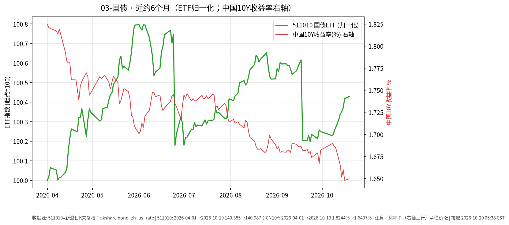

# 国债日报 2026-10-20

> 日历日：2026-10-20（周二）。开盘前报告；上一交易日为 **2026-10-19**。行情与图表截至该日。图中若含中国 10Y 收益率，请注意：**利率↑（右轴上行）≠债价涨**。

## 市场状态

国债 ETF（511010）近约 6 个月价格小幅上行；中国 10 年期国债收益率自 4 月初附近整体下行。上一交易日（10-19）511010 近乎持平微涨；中债 10Y 收益率较前一交易日（10-16）略升约 0.17 bp。

## 关键数据

| 标的 | 数据日 | 收盘/水平 | 较前一交易日 | 窗口起点→终点 |
|------|--------|-----------|--------------|---------------|
| 511010（国债 ETF） | 2026-10-19 | 140.987 | **+0.011%**（前收 140.972） | 2026-04-01→10-19：价格 **约 +0.43%** |
| 中国国债收益率 10Y（akshare） | 2026-10-19 | 1.6497% | **约 +0.17 bp**（前值 1.6480%，2026-10-16） | 2026-04-01→2026-10-19：约 **-17.5 bp** |
| 美国国债收益率 10Y（参考） | 2026-10-19 | 5.15% | 约 +6.0 bp | 窗口约 +82.0 bp |

## 简要解读

- 511010 近半年价格略涨；中国 10Y 收益率从约 1.8244% 附近下行到约 1.6497%。
- 10-19：ETF 价格变动极小；收益率较 10-16 略升约 0.17 bp（幅度有限）。
- 读图时记住：收益率曲线往上走，通常对应债价承压；本图右轴为收益率水平，左轴为 ETF 归一化价格。

## 关注点与风险

- **久期与利率**：长久期利率债对收益率变动更敏感；短端资金面与政策预期变化也会传导至曲线。
- **ETF 折溢价**：场内价格可能偏离净值。
- **数据口径**：511010 新浪日 K；收益率来自 akshare `bond_zh_us_rate`。

## 来源与时间

- 511010：新浪财经日 K
- 中美 10Y：akshare `bond_zh_us_rate`
- 图表区间：约 2026-04-01 至 2026-10-19
- 整理时间：2026-10-20 约 05:30–06:00 Asia/Shanghai
