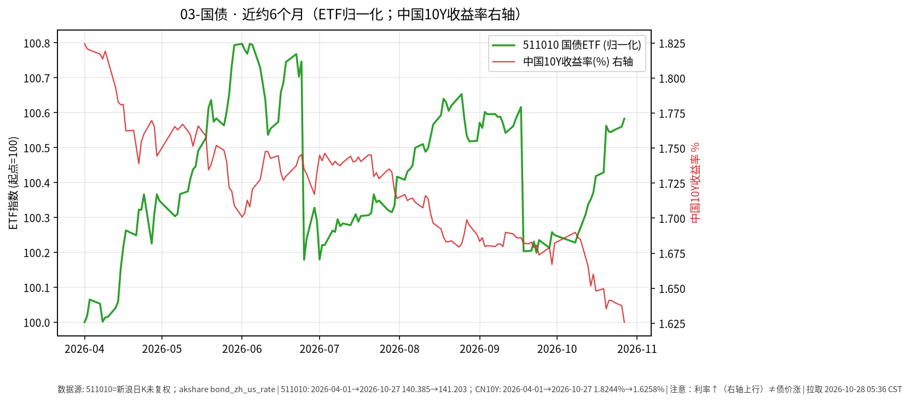

# 国债 · 日报 2026-10-28

## 市场状态
- **报告日**：2026-10-28；**数据截止交易日**：**2026-10-27**。
- 国债 ETF 511010 收 **141.203**，日涨跌 **+0.023%**（近乎持平）。
- 中债国债收益率曲线 **10 年期** 2026-10-27 报 **1.6258%**，较上一交易日（2026-10-26 的 1.6376%）约 **-1.18 BP**（中国债券信息网 pbc/more 与 akshare `bond_zh_us_rate` 一致）。
- **提醒**：利率上行（曲线抬升）通常对应既有国债价格承压；图中 ETF 净值涨 ≠ 收益率涨。**利率↑线↑≠债价涨**。

## 关键数据
| 标的 | 收盘日 | 收盘/收益率 | 日变化 | 约6个月 | 区间 |
|------|--------|-------------|--------|---------|------|
| 511010 | 2026-10-27 | 141.203 | +0.023% | 2026-04-27→2026-10-27 | +0.36% |
| 中债10Y国债收益率 | 2026-10-27 | 1.6258% | 约-1.18 BP | 2026-04-01→2026-10-27 | 约 -19.9 BP（akshare 序列） |

## 简要解读
- 511010 近半年归一涨跌约 **+0.36%**，路径相对平缓；2026-10-27 微升，与 10Y 收益率较前一日下行约 1.18 BP 的方向一致（利率↓有利于存量债价）。
- 久期越长，对收益率变化越敏感；本页只记录 ETF 收盘与曲线点位。图中右轴叠加中国10Y收益率日序。

## 关注点与风险
- 利率风险：收益率上行 → 债券市价下行。
- 通胀预期、货币政策与供需（供给放量等）都会改变曲线形态。
- 收益率序列来自公开曲线汇总，与 ETF 交易价时间戳不完全同步。

## 来源与时间
- 511010：新浪日 K；截止 2026-10-27
- 收益率：yield.chinabond.com.cn pbc/more（2026-10-27，10Y=1.6258%）；日序 akshare `bond_zh_us_rate`
- 图表：matplotlib，ETF 收盘归一=100，中国10Y 收益率右轴
