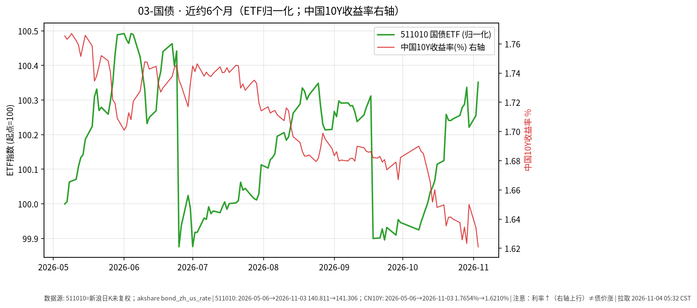

# 国债 · 日报 2026-11-04

## 市场状态
- **报告日**：2026-11-04；**数据截止交易日**：**2026-11-03**。
- 国债 ETF 511010 收 **141.306**，日涨跌 **+0.096%**。
- 中债国债收益率曲线 **10 年期** 2026-11-03 报 **1.6210%**，较上一可得日（2026-11-02 的 1.6343%）约 **-1.33 BP**（akshare `bond_zh_us_rate`）。
- **提醒**：利率上行（曲线上移）通常对应既有国债价格承压；图中 ETF 净值涨 ≠ 收益率涨。**利率↑线↑≠债价涨**。

## 关键数据
| 标的 | 收盘日 | 收盘/收益率 | 日变化 | 约6个月 | 区间 |
|------|--------|-------------|--------|---------|------|
| 511010 | 2026-11-03 | 141.306 | +0.096% | 2026-05-06→2026-11-03 | +0.35% |
| 中债10Y国债收益率 | 2026-11-03 | 1.6210% | 约-1.33 BP | 2026-05-06→2026-11-03 | 约 -14.44 BP（akshare 序列） |

## 简要解读
- 511010 近半年归一涨跌约 **+0.35%**，路径相对平缓；2026-11-03 微涨，同时 10Y 收益率较前一可得日约 -1.33 BP（利率下行对存量债价偏支撑，与 ETF 同日微涨方向一致，但单日仍可能受供需/折溢价影响）。
- 久期越长，对收益率变化越敏感；本页只记录 ETF 收盘与曲线点位。图中右轴叠加中国10Y收益率日序。

## 关注点与风险
- 利率风险：收益率上行 → 债券市价下行。
- 通胀预期、货币政策与供需（供给放量等）都会改变曲线形态。
- 收益率序列来自公开曲线汇总，与 ETF 交易价时间戳不完全同步。

## 来源与时间
- 511010：新浪日 K；截止 2026-11-03
- 收益率：akshare `bond_zh_us_rate`（2026-11-03，10Y=1.6210%）
- 图表：matplotlib，ETF 收盘归一=100，中国10Y 收益率右轴；图注已写「利率↑线↑≠债价涨」；拉取约 2026-11-04 05:32:52 CST
