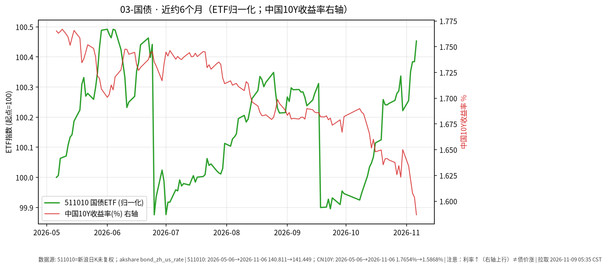

# 国债 · 日报 2026-11-09

## 市场状态
- **报告日**：2026-11-09（周一盘前）；**数据截止交易日**：**2026-11-06**。周末休市，今日尚未开盘；本页数字不含周一盘中。
- 国债 ETF 511010 收 **141.449**，日涨跌 **+0.069%**。
- 中债国债收益率曲线 **10 年期** 2026-11-06 报 **1.5868%**，较上一可得日（2026-11-05 的 1.6038%）约 **-1.70 BP**（akshare `bond_zh_us_rate`）。
- **提醒**：利率上行（曲线上移）通常对应既有国债价格承压；图中 ETF 净值涨 ≠ 收益率涨。**利率↑线↑≠债价涨**。

## 关键数据
| 标的 | 收盘日 | 收盘/收益率 | 日变化 | 约6个月 | 区间 |
|------|--------|-------------|--------|---------|------|
| 511010 | 2026-11-06 | 141.449 | +0.069% | 2026-05-06→2026-11-06 | +0.45% |
| 中债10Y国债收益率 | 2026-11-06 | 1.5868% | 约-1.70 BP | 2026-05-06→2026-11-06 | 约 -17.86 BP（akshare 序列） |

## 简要解读
- 511010 近半年归一涨跌约 **+0.45%**，路径相对平缓；2026-11-06 日涨跌 +0.069%，同时 10Y 收益率较前一可得日约 -1.70 BP（利率下行通常对存量债价偏友好，单日仍可能受供需/折溢价影响）。
- 久期越长，对收益率变化越敏感；本页只记录 ETF 收盘与曲线点位。图中右轴叠加中国10Y收益率日序。

## 关注点与风险
- 利率风险：收益率上行 → 债券市价下行。
- 通胀预期、货币政策与供需（供给放量等）都会改变曲线形态。
- 收益率序列来自公开曲线汇总，与 ETF 交易价时间戳不完全同步。

## 来源与时间
- 511010：新浪日 K；截止 2026-11-06
- 收益率：akshare `bond_zh_us_rate`（2026-11-06，10Y=1.5868%）
- 图表：matplotlib，ETF 收盘归一=100，中国10Y 收益率右轴；图注已写「利率↑线↑≠债价涨」；拉取约 2026-11-09 05:35:44 CST

## 今日一点
# 今日一点 · Day 11/100 · 《单位净值、估值日、T+N》

**结论：** 看债基或货基，单位净值是「每一份今天值多少」；按哪天成交、钱何时能用，取决于估值日和 T+N，屏幕数字不是落袋现金。

**机制：** 基金公司在每个交易日收盘后算出当天单位净值，这一天就是估值日；你在规定时点前申购或赎回，才锁定哪天净值。货基常见当日或次日可用，债基赎回多为 T+1 或 T+2 到账；ETF 场内买卖即时成交，和场外申赎不是同一条路径。债底仓票息清晰，要先分清净值更新日和资金可用日——应急金不该压在尚未到账的份额上；以后若划拨股票卫星，A 股卖出也有 T+1 交收，节奏要和动用年限对上。今天只讲结算节奏，不定买卖。
