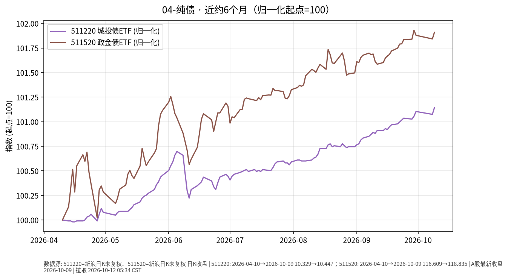

# 纯债日报 · 2026-10-12

> 日历说明：报告日 **2026-10-12（周一）清晨 CST**；最新收盘取 **2026-10-09**（国庆后第二交易日；10/10 为周六休市）。

## 1. 市场状态

- 10/9 信用/政金债 ETF 价格小幅上行：城投债 ETF **511220**、政金债 ETF **511520** 日涨幅约 **0.07%** 量级，波动仍远小于权益。
- 债市环境（新华财经 10/9）：利率债收益率回落、国债期货全线上涨；信用债方面公开日评称中短票收益率曲线总体稳定。资金面短端利率下行，对中长久期纯债价格构成温和支撑叙述（事实层面：价格与利率方向同日一致）。
- 近半年：两只样本 ETF 价格累计升幅约 **1.1%～1.9%**，路径相对平滑。

## 2. 关键数据

| 标的 | 最新交易日 | 收盘 | 日变动 | 相对9/30 | 近约6个月（自约2026-04-10） |
|------|------------|------|--------|----------|------------------------------|
| **511220** 城投债ETF | 2026-10-09 | **10.447** | **+0.067%** | **+0.038%** | 约 **+1.14%** |
| **511520** 政金债ETF | 2026-10-09 | **118.835** | **+0.066%** | **+0.029%** | 约 **+1.91%** |

（新浪财经日K `close`；图表归一化 start=100。）

## 3. 简要解读

- 10/9 两只纯债 ETF 同步微涨，与当日利率小幅下行的公开债市描述方向一致。
- 近 6 个月 511520（久期通常更长）价格升幅大于 511220，符合“利率下行时更长久期价格弹性更大”的一般事实关系；亦意味着利率回升时回撤可能更大——仅为敏感度事实。
- 价格变动未计入分红再投；总回报需以基金净值与分红公告为准。

## 4. 关注点与风险

- **信用利差**：城投债对区域与行业信用事件更敏感；政金债更接近利率债，但仍有流动性与基差风险。
- **久期与利率**：中长久期品种对利率上行更敏感。
- **折溢价与流动性**：ETF 二级市场成交与 IOPV 可能短暂偏离。
- 杠杆、下沉等策略不在本报告讨论范围；本文仅陈述公开价格路径。

## 5. 来源与时间

- 行情：新浪财经日K —— **2026-10-12 约 05:34 CST**。
- 债市环境：新华财经《债市日报：10月9日》；中债估值中心日评（信用品种曲线描述）。
- 声明：事实梳理，**非投资建议**。
