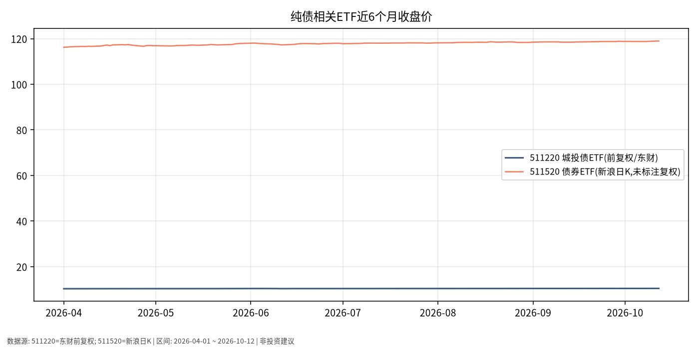

# 纯债日报 · 2026-10-13

> 日历日：2026-10-13（周二）为 **A 股交易日**；本篇关键报价截至 **2026-10-12 收盘（写稿时点为 10-13 盘前，当日 A 股尚未开盘/收盘）**。  
> 原则：只描述市场如何变化，不构成买卖或加仓建议。

## 市场状态

- **511220**（城投债 ETF，东财前复权）近 6 个月由约 10.309 至 **10.447**（约 **+1.34%**），与国债 ETF 同期价格变动量级接近，日波动显著小于权益。
- **511520**（债券 ETF，新浪日K，未在源标注复权）同窗口由约 116.209 至 **118.970**（约 **+2.38%**）；因数据源复权口径可能不同，两序列**不宜直接比较绝对涨幅优劣**，仅作路径对照。
- 10-12：511220 日涨跌幅 **0.00%**（收盘 10.447，与 10-09 持平）；511520 相对 10-09 约 **+0.11%**。

## 关键数据

| 标的 | 最新收盘 | 近期变动 | 近6个月 | 截止 | 复权说明 |
|------|----------|----------|---------|------|----------|
| 511220 | 10.447 | 10-12 涨跌幅 0.00% | 10.309 → 10.447（约 +1.34%） | 2026-10-12 | 东财前复权 |
| 511520 | 118.970 | 约 +0.11%（10-09→10-12） | 116.209 → 118.970（约 +2.38%） | 2026-10-12 | 新浪日K（未标注复权） |
| 511220 国庆后 | — | 10-08→10-12 约 +0.07% | 10.440 → 10.447 | — | — |

## 简要解读

- **信用债/城投相关 ETF 价格**：在观察窗口内整体温和上行，曲线平滑度介于短债与权益之间。
- **风险溢价维度（事实框架）**：相对利率债，信用债还需额外面对发行人信用与流动性溢价变化；价格平稳**不等于**信用风险消失。
- **数据源差异**：511220 与 511520 来自不同接口与可能不同的复权处理，解读时以各自基金净值/公告为准更严谨。

## 关注点与风险

- **信用与行业政策**：城投及信用品种对区域财政、化债政策、评级迁移敏感；本篇不评估单一发行人。
- **流动性与折溢价**：部分债券 ETF 成交不如宽基活跃，大额交易可能冲击价格。
- **利率与利差双因素**：即使利率下行，若信用利差走阔，信用债 ETF 仍可能表现落后于纯利率债——需同时观察两类价格路径。
- **当日未收盘**：以 10-13 收盘与净值更新为准。

## 来源与时间

- 511220：东方财富 K 线接口，**前复权**（`fqt=1`）
- 511520：新浪 `fund_etf_hist_sina` 日K（图注已标明未标注复权）
- 绘图区间：2026-04-01 ~ 2026-10-12；写稿时间：2026-10-13 05:45 Asia/Shanghai (CST, UTC+8)
- 图表：`./charts/纯债-6m.png`
