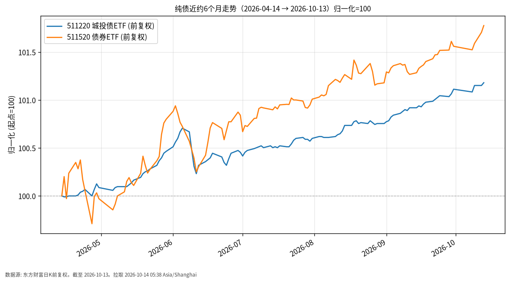

# 纯债日报 · 2026-10-14（周三）

## 1. 市场状态
- **数据截至 2026-10-13**（周三凌晨日报，A 股当日未收盘）。
- 信用债/城投相关 ETF 与更宽基债券 ETF 近6个月均为缓慢上行；日度涨跌多在万分之几量级。
- 与利率债类似，近期资金面偏松对债市价格形成支撑，但信用利差与个券流动性仍是差异来源。

## 2. 关键数据
| 标的 | 最新价 | 日涨跌 | 近约6个月（自 2026-04-14） | 数据截至 |
|------|--------|--------|-------------------------|----------|
| 511220 城投债ETF | 10.450 | +0.03% | +1.18%（10.328→10.450） | 2026-10-13 |
| 511520 债券ETF | 119.053 | +0.07% | +1.78%（116.974→119.053） | 2026-10-13 |

- 511520 近6个月累计约 +1.78%，略高于 511220 的约 +1.18%（前复权价格口径），反映成分/久期/票息结构差异，不作优劣判断。

## 3. 简要解读
- **事实路径**：双线归一化后均位于起点 100 上方，斜率平缓，期间未见权益式大幅回撤。
- 2026-10-13 两只均小幅收涨，与当日债市整体偏强的公开描述一致。
- 「纯债」仍承担利率与信用风险，只是波动通常低于股债混合或高股息权益。

## 4. 关注点与风险
- 信用事件、城投区域分化、评级迁移可能导致利差走阔与净值波动。
- 利率快速上行阶段，中长久期纯债回撤可能显著大于中短债。
- ETF 流动性、折溢价；本日报仅陈述已实现价格路径。

## 5. 来源与时间
- 511220 / 511520：东方财富公开日K，前复权
- 债市背景：公开收盘报道（2026-10-13）
- 拉取时间：2026-10-14 05:38 Asia/Shanghai
- **数据截至**：2026-10-13

## 6. 近6个月走势图

