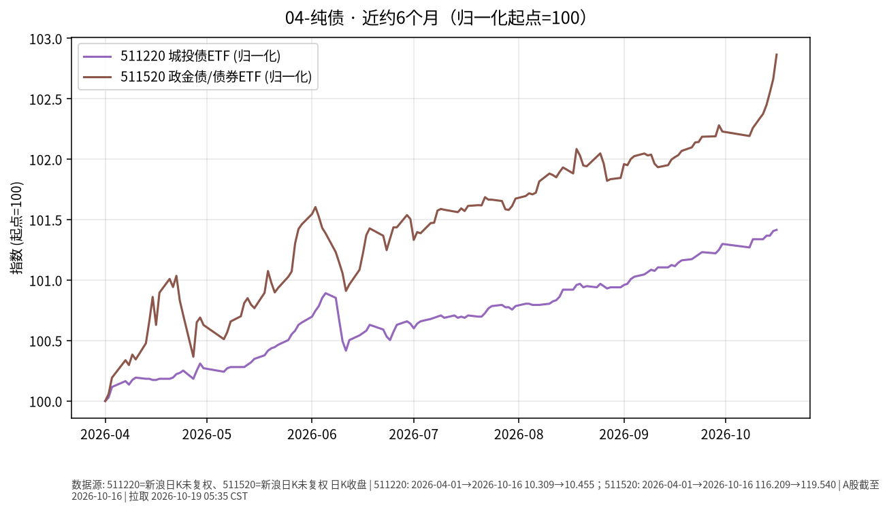

# 纯债日报 2026-10-19

> 日历日：2026-10-19（周一）。开盘前报告；行情与图表截至**上一交易日 2026-10-16**（新浪交易日历；10-17 不在交易日列表）。

## 市场状态

纯债相关 ETF 近约 6 个月整体小幅上行。511520 窗口内涨幅大于 511220；上一交易日两者均上涨，511520 单日幅度更大。

## 关键数据

| 标的 | 数据日 | 收盘 | 较前一交易日 | 窗口起点→终点涨跌 |
|------|--------|------|--------------|-------------------|
| 511220（城投债 ETF） | 2026-10-16 | 10.455 | **+0.010%**（前收 10.454） | 2026-04-01→10-16：**约 +1.42%** |
| 511520（债券 ETF） | 2026-10-16 | 119.540 | **+0.198%**（前收 119.304） | 2026-04-01→10-16：**约 +2.87%** |

图表归一化起点=100（两只标的绝对价格量纲不同，勿直接比绝对价）。

## 简要解读

- 近半年两者均录得正的价格变动，但幅度与波动节奏并不相同——信用债/组合久期与券种结构差异会导致路径分叉。
- 10-16：511220 近乎持平微涨；511520 上涨约 0.20%。
- 价格变动只是路径的一部分；票息、估值波动、费用与折溢价共同影响持有体验。

## 关注点与风险

- **信用与流动性**：城投/信用类持仓对利差与个券流动性更敏感，极端行情下净值波动可能大于利率债。
- **利率联动**：若市场利率快速上行，纯债 ETF 也可能出现净值回撤。
- **数据口径**：新浪日 K 收盘价；511220 报价量纲与 511520 不同，比较请用归一化图或涨跌幅。

## 来源与时间

- 新浪财经日 K：511220、511520
- 图表区间：2026-04-01 → 2026-10-16
- 整理时间：2026-10-19 约 05:30–06:00 Asia/Shanghai
