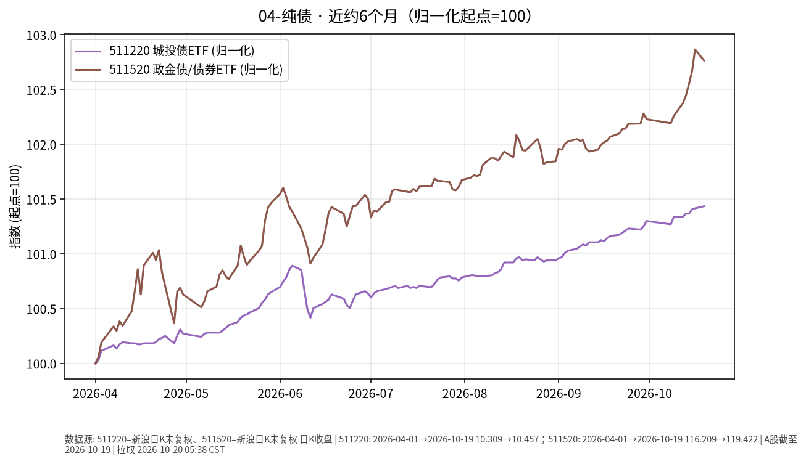

# 纯债日报 2026-10-20

> 日历日：2026-10-20（周二）。开盘前报告；上一交易日为 **2026-10-19**。行情与图表截至该日。

## 市场状态

城投债/政金债相关 ETF 近约 6 个月价格整体小幅上行。上一交易日（10-19）511220 微涨、511520 小幅回落，单日方向不完全一致。

## 关键数据

| 标的 | 数据日 | 收盘 | 较前一交易日 | 窗口起点→终点涨跌 |
|------|--------|------|--------------|-------------------|
| 511220（城投债 ETF） | 2026-10-19 | 10.457 | **+0.019%**（前收 10.455） | 2026-04-01→10-19：**约 +1.44%** |
| 511520（政金债/债券 ETF） | 2026-10-19 | 119.422 | **-0.10%**（前收 119.540） | 2026-04-01→10-19：**约 +2.76%** |

图表归一化起点=100。

## 简要解读

- 近半年两者均为正的价格变动，511520 累计幅度更大一些。
- 10-19：511220 接近平盘微涨；511520 回落约 0.10%，与中短债/国债 ETF 的极小波动相比略更可见。
- 信用债与利率债成分、久期结构不同，单日分化属常见现象。

## 关注点与风险

- **信用与利差**：城投等信用品种对利差与个券事件更敏感。
- **利率与久期**：收益率上行时，较长久期组合净值可能承压。
- **折溢价与流动性**：场内买卖价差可能随成交活跃度变化。
- **数据口径**：新浪日 K 收盘价。

## 来源与时间

- 新浪财经日 K：511220、511520
- 图表区间：2026-04-01 → 2026-10-19
- 整理时间：2026-10-20 约 05:30–06:00 Asia/Shanghai
