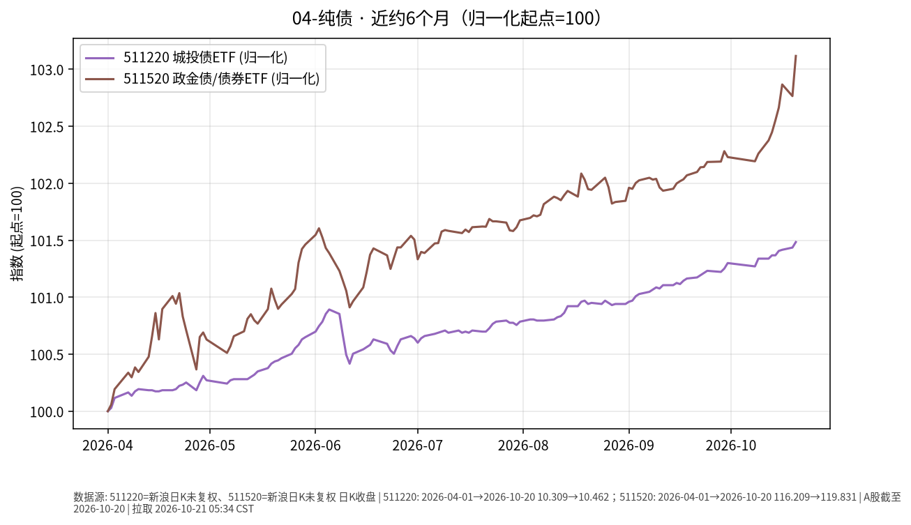

# 纯债日报 2026-10-21

> 日历日：2026-10-21（周三）。开盘前报告；上一交易日为 **2026-10-20**。行情与图表截至该日。

## 市场状态

城投债/政金债相关 ETF 近约 6 个月价格整体小幅上行。上一交易日（10-20）511220、511520 均上涨，511520 单日幅度相对更大。

## 关键数据

| 标的 | 数据日 | 收盘 | 较前一交易日 | 窗口起点→终点涨跌 |
|------|--------|------|--------------|-------------------|
| 511220（城投债 ETF） | 2026-10-20 | 10.462 | **+0.05%**（前收 10.457） | 2026-04-01→10-20：**约 +1.48%** |
| 511520（政金债/债券 ETF） | 2026-10-20 | 119.831 | **+0.34%**（前收 119.422） | 2026-04-01→10-20：**约 +3.12%** |

图表归一化起点=100。

## 简要解读

- 近半年两者均为正的价格变动，511520 累计幅度更大一些。
- 10-20：511220 微涨约 0.05%；511520 上涨约 0.34%，与前一日（10-19）511520 小跌形成对比。
- 信用债与利率债成分、久期结构不同，单日分化属常见现象。

## 关注点与风险

- **信用与利差**：城投等信用品种对利差与个券事件更敏感。
- **利率与久期**：收益率上行时，较长久期组合净值可能承压。
- **折溢价与流动性**：场内买卖价差可能随成交活跃度变化。
- **数据口径**：新浪日 K 收盘价。

## 来源与时间

- 新浪财经日 K：511220、511520
- 图表区间：2026-04-01 → 2026-10-20
- 整理时间：2026-10-21 约 05:30–06:00 Asia/Shanghai
