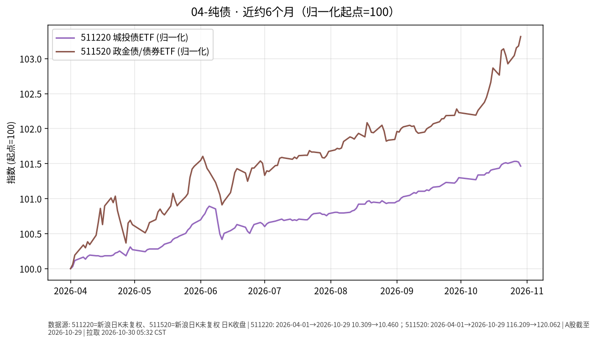

# 纯债 · 日报 2026-10-30

## 市场状态
- **报告日**：2026-10-30；**数据截止交易日**：**2026-10-29**。
- 城投债 ETF 511220 收 **10.460**（**-0.057%**）。
- 政金债/债券 ETF 511520 收 **120.062**（**+0.131%**）。
- 511220 微跌、511520 微升；近半年仍呈缓慢抬升。

## 关键数据
| 标的 | 收盘日 | 收盘 | 日涨跌 | 约6个月区间 | 区间涨跌 |
|------|--------|------|--------|-------------|----------|
| 511220 城投债ETF海富通 | 2026-10-29 | 10.460 | -0.057% | 2026-04-29→2026-10-29 | +1.15% |
| 511520 政金债ETF富国 | 2026-10-29 | 120.062 | +0.131% | 2026-04-29→2026-10-29 | +2.61% |

## 简要解读
- 近半年归一：511220 约 **+1.15%**，511520 约 **+2.61%**；2026-10-29 前者微跌、后者微升。
- 城投债含信用利差暴露，政金债更偏利率；并排对照路径，不评价孰优。

## 关注点与风险
- 信用利差扩张时，城投/信用类净值回撤可能大于利率债。
- 利率上行同样压制久期更长的品种。
- ETF 折溢价与跟踪误差；本报告不讨论杠杆与下沉信用。

## 来源与时间
- 新浪 CN_MarketData 日 K，截止 2026-10-29
- 图表：matplotlib，起点归一=100
