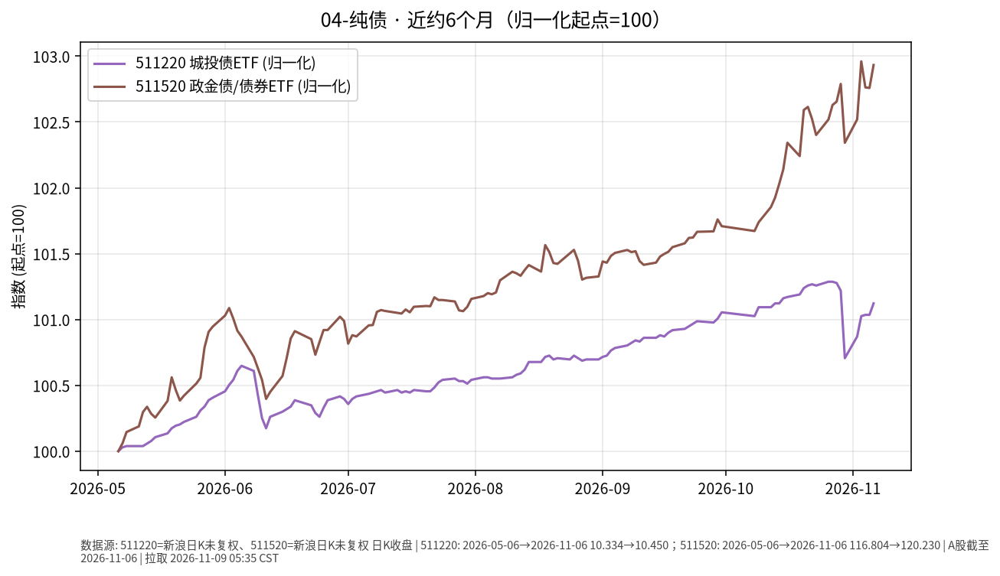

# 纯债 · 日报 2026-11-09

## 市场状态
- **报告日**：2026-11-09（周一盘前）；**数据截止交易日**：**2026-11-06**。周末休市，今日尚未开盘；本页数字不含周一盘中。
- 城投债 ETF 511220 收 **10.450**（**+0.086%**）。
- 政金债/债券 ETF 511520 收 **120.230**（**+0.170%**）。
- 两品种单日变动较小；近半年仍呈缓慢抬升。

## 关键数据
| 标的 | 收盘日 | 收盘 | 日涨跌 | 约6个月区间 | 区间涨跌 |
|------|--------|------|--------|-------------|----------|
| 511220 城投债ETF海富通 | 2026-11-06 | 10.450 | +0.086% | 2026-05-06→2026-11-06 | +1.12% |
| 511520 政金债ETF富国 | 2026-11-06 | 120.230 | +0.170% | 2026-05-06→2026-11-06 | +2.93% |

## 简要解读
- 近半年归一：511220 约 **+1.12%**，511520 约 **+2.93%**；2026-11-06 两品种分别约 +0.086% / +0.170%，属已发生价格事实。
- 城投债含信用利差暴露，政金债更偏利率；并排对照路径，不评价孰优。

## 关注点与风险
- 信用利差扩张时，城投/信用类净值回撤可能大于利率债。
- 利率上行同样压制久期更长的品种。
- ETF 折溢价与跟踪误差；本报告不讨论杠杆与下沉信用。

## 来源与时间
- 新浪 CN_MarketData 日 K，截止 2026-11-06
- 图表：matplotlib，起点归一=100；拉取约 2026-11-09 05:35:44 CST

## 今日一点
# 今日一点 · Day 11/100 · 《单位净值、估值日、T+N》

**结论：** 看债基或货基，单位净值是「每一份今天值多少」；按哪天成交、钱何时能用，取决于估值日和 T+N，屏幕数字不是落袋现金。

**机制：** 基金公司在每个交易日收盘后算出当天单位净值，这一天就是估值日；你在规定时点前申购或赎回，才锁定哪天净值。货基常见当日或次日可用，债基赎回多为 T+1 或 T+2 到账；ETF 场内买卖即时成交，和场外申赎不是同一条路径。债底仓票息清晰，要先分清净值更新日和资金可用日——应急金不该压在尚未到账的份额上；以后若划拨股票卫星，A 股卖出也有 T+1 交收，节奏要和动用年限对上。今天只讲结算节奏，不定买卖。
