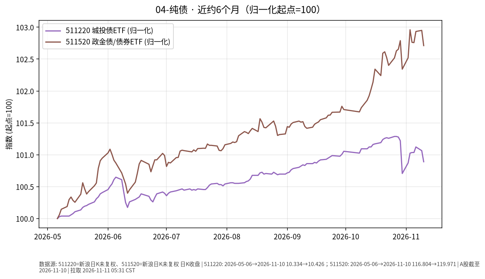

# 纯债 · 日报 2026-11-11

## 市场状态
- **报告日**：2026-11-11（周三盘前）；**数据截止交易日**：**2026-11-10**。今日尚未开盘；本页数字不含周三盘中。
- 城投债 ETF 511220 收 **10.426**（**-0.172%**）。
- 政金债/债券 ETF 511520 收 **119.971**（**-0.232%**）。
- 两品种同日小幅回落；近半年仍呈缓慢抬升。

## 关键数据
| 标的 | 收盘日 | 收盘 | 日涨跌 | 约6个月区间 | 区间涨跌 |
|------|--------|------|--------|-------------|----------|
| 511220 城投债ETF海富通 | 2026-11-10 | 10.426 | -0.172% | 2026-05-06→2026-11-10 | +0.89% |
| 511520 政金债ETF富国 | 2026-11-10 | 119.971 | -0.232% | 2026-05-06→2026-11-10 | +2.71% |

## 简要解读
- 近半年归一：511220 约 **+0.89%**，511520 约 **+2.71%**；2026-11-10 两品种分别约 -0.172% / -0.232%，属已发生价格事实。同日 10Y 国债收益率约上行 0.91 BP，利率债与信用债 ETF 均小幅回落，仅作路径对照。
- 城投债含信用利差暴露，政金债更偏利率；并排对照路径，不评价孰优。

## 关注点与风险
- 信用利差扩张时，城投/信用类净值回撤可能大于利率债。
- 利率上行同样压制久期更长的品种。
- ETF 折溢价与跟踪误差；本报告不讨论杠杆与下沉信用。

## 来源与时间
- 新浪 CN_MarketData 日 K，截止 2026-11-10
- 图表：matplotlib，起点归一=100；拉取约 2026-11-11 05:31:22 CST
