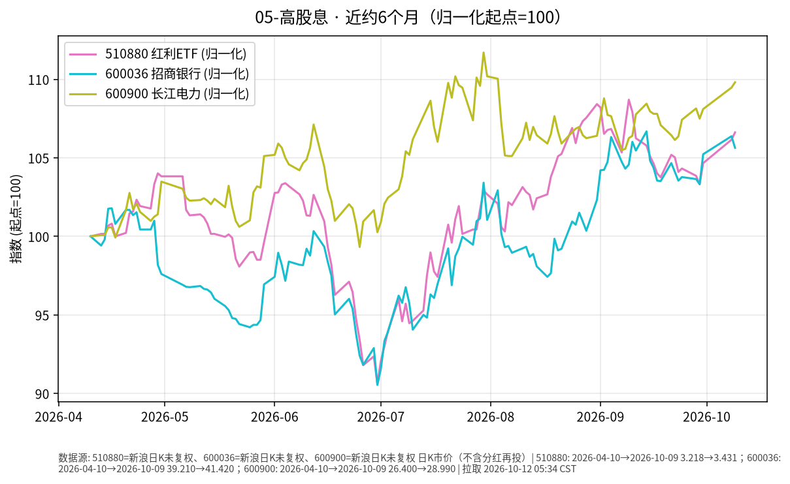

# 高股息日报 · 2026-10-12

> 日历说明：报告日 **2026-10-12 清晨 CST**；最新收盘 **2026-10-09（周五）**。国庆后第二交易日，三大指数探底回升收涨；**红利风格内部有所分化**（公开盘面：煤炭等偏强，银行回调）。

## 1. 市场状态

- 10/9 上证指数收报 **3813.79**，约 **+0.05%**；深成指约 **+0.17%** 报 **12641.86**；创业板指约 **+0.22%** 报 **3043.33**；科创50约 **+0.07%**。沪深两市成交额约 **1.90～1.92 万亿元**，较前一日放量。
- 风格：公开报道称红利资产整体仍偏强（中证红利约 **+0.82%**、实现三连涨），但内部走分——煤炭领涨、保险/电力小幅走强，**银行板块回调**；红利低波指数微跌约 **0.25%～0.3%**。
- 样本标的：红利 ETF **510880** 上涨约 **+0.44%**；长江电力 **600900** 约 **+0.31%**；招商银行 **600036** 约 **-0.70%**。

## 2. 关键数据

| 标的 | 最新交易日 | 收盘 | 日变动 | 相对9/30 | 近约6个月（自约2026-04-10） |
|------|------------|------|--------|----------|------------------------------|
| **510880** 华泰柏瑞红利ETF | 2026-10-09 | **3.431** | **+0.44%** | **+1.87%** | 约 **+6.62%** |
| **600036** 招商银行 | 2026-10-09 | **41.42** | **-0.70%** | **+0.39%** | 约 **+5.64%** |
| **600900** 长江电力 | 2026-10-09 | **28.99** | **+0.31%** | **+1.58%** | 约 **+9.81%** |

图表为三标的 close 归一化 start=100（新浪日K；市价口径，**不含分红再投**；长期比较请核对除权除息）。

## 3. 简要解读

- 10/9 宽基窄幅收涨，红利指数相对强于大盘，但样本内银行回调、水电/红利 ETF 小涨，说明高股息并非同涨同跌。
- 近 6 个月三标的价格累计升幅约 **5.6%～9.8%**，显著高于同期债券 ETF 的价格变动，也与黄金 ETF 回撤形成对照——仅陈述分化事实。
- 公开分红日历：具体除权除息日以交易所与公司公告为准；本报告不编造未核实的派息日期。

## 4. 关注点与风险

- **风格切换可逆**：若风险偏好回升或成长风格占优，红利相对优势可能阶段性减弱。
- **盈利与分红**：银行净息差、水电来水与电价政策等基本面因素会影响分红可持续性。
- **估值与拥挤度**：资金集中流入时波动与回撤风险上升；10/9 中证红利成交放量（公开笔记称量比抬升）意味着分歧可能加大。
- **口径**：价格收益 ≠ 含分红总回报；ETF 跟踪误差与费用需单独查看。

## 5. 来源与时间

- 个股/ETF/指数：新浪财经日K —— **2026-10-12 约 05:34 CST**。
- 指数与风格：东方财富/雪球/每日经济新闻等 10/9 收盘与红利板块公开报道。
- 休市安排：上交所 2026 年国庆休市安排（10/10 为周六）。
- 声明：事实梳理，**非投资建议**。
