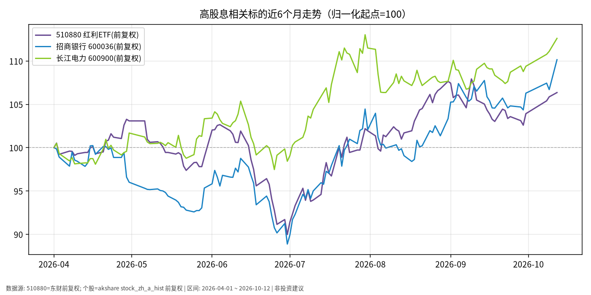

# 高股息日报 · 2026-10-13

> 日历日：2026-10-13（周二）为 **A 股交易日**；本篇关键报价截至 **2026-10-12 收盘（写稿时点为 10-13 盘前，当日 A 股尚未开盘/收盘）**。  
> 原则：只描述市场如何变化，不构成买卖或加仓建议。

## 市场状态

- 观察窗口内（归一化起点=100），**长江电力 600900**、**招商银行 600036** 累计涨幅高于 **510880**（红利 ETF）：截至 10-12，三者近 6 个月分别约 **+12.6%**、**+10.1%**、**+6.4%**（均为前复权收盘口径）。
- 国庆后复市至 10-12：510880 约 +0.91%，招行约 +2.52%，长电约 +1.66%；其中 10-12 招行单日涨跌幅约 **+3.24%**，波动明显高于债券类 ETF。
- 相对黄金近 6 个月的回撤路径，高股息样本在本窗口表现为正收益区间——此为**历史价格事实**，不推断未来相对强弱。

## 关键数据

| 标的 | 最新收盘 | 10-12 涨跌幅 | 近6个月（前复权） | 国庆后 10-08→10-12 | 截止 |
|------|----------|--------------|-------------------|---------------------|------|
| 510880 红利ETF | 3.447 | **+0.47%** | 3.241 → 3.447（约 **+6.36%**） | 3.416 → 3.447（约 +0.91%） | 2026-10-12 |
| 招商银行 600036 | 42.76 | **+3.24%** | 38.82 → 42.76（约 **+10.15%**） | 41.71 → 42.76（约 +2.52%） | 2026-10-12 |
| 长江电力 600900 | 29.38 | **+1.35%** | 26.09 → 29.38（约 **+12.61%**） | 28.90 → 29.38（约 +1.66%） | 2026-10-12 |

## 简要解读

- **价格路径**：三序列在 4 月以来整体上行，但中途有回撤与分化；个股弹性大于 ETF，ETF 更接近一篮子红利风格的平均路径。
- **“高股息”≠低波动**：10-12 招行约 3% 的单日波幅说明分红型个股仍可能出现显著日内/日间波动；稳定分红历史也不等于价格稳定。
- **复权说明**：图与表均为**前复权**收盘，反映含分红再投资假设下的价格连续序列；若看未复权市价或现金分红到账体验，数字会不同。

## 关注点与风险

- **盈利与分红政策变化**：银行息差、资产质量；水电来水与电价机制等，均可能影响未来分红能力——本篇不预测财报。
- **风格与估值波动**：红利风格可能阶段性跑赢或跑输大盘；相对强弱会切换。
- **集中度**：单持招行或长电 vs 持有 510880，个股 idiosyncratic 风险不同。
- **10-13 盘前写稿**：当日涨跌以收盘为准；A 股为交易日，可关注盘后更新。

## 来源与时间

- 510880：东财 K 线，**前复权**
- 600036、600900：akshare `stock_zh_a_hist`，**前复权**
- 绘图区间：2026-04-01 ~ 2026-10-12；写稿时间：2026-10-13 05:45 Asia/Shanghai (CST, UTC+8)
- 图表：`./charts/高股息-6m.png`
