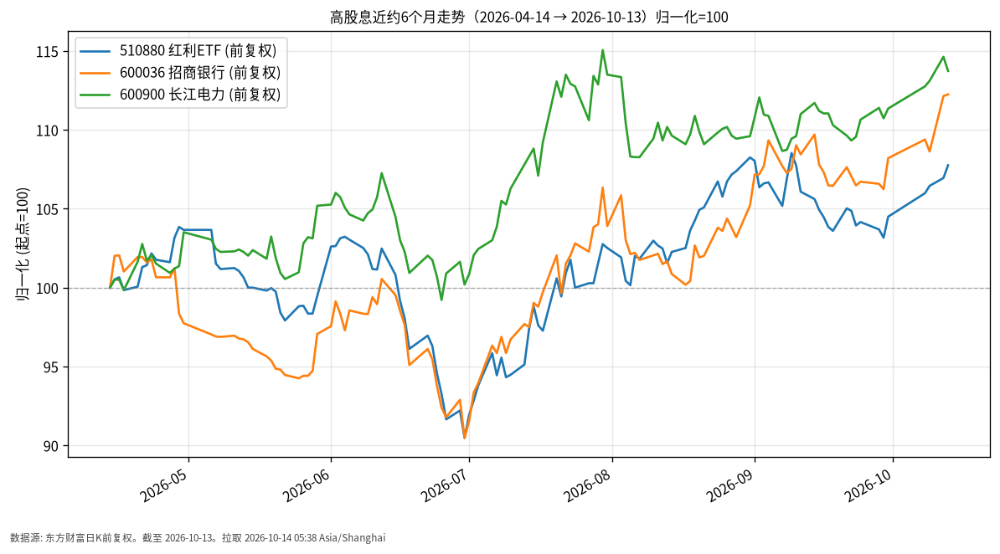

# 高股息日报 · 2026-10-14（周三）

## 1. 市场状态
- **数据截至 2026-10-13**：A 股探底回升、放量收红（公开报道成交额约 1.68 万亿元）；红利相关 ETF 在风险偏好回落时相对抗跌/获资金关注（公开 ETF 综述）。
- 跟踪组合：华泰柏瑞红利 ETF（510880）+ 招商银行（600036）+ 长江电力（600900）。
- 近约6个月三者前复权价格均录得正收益，波动明显高于债券门类。

## 2. 关键数据
| 标的 | 最新价 | 日涨跌 | 近约6个月（自 2026-04-14） | 数据截至 |
|------|--------|--------|-------------------------|----------|
| 510880 红利ETF | 3.473 | +0.75% | +7.76%（3.223→3.473） | 2026-10-13 |
| 600036 招商银行 | 42.80 | +0.09% | +12.25%（38.13→42.80） | 2026-10-13 |
| 600900 长江电力 | 29.15 | -0.78% | +13.73%（25.63→29.15） | 2026-10-13 |

- 2026-10-13：510880 +0.75%，招行 +0.09%，长电 -0.78%；个股日内分化明显。
- 价格口径为东方财富前复权收盘，便于跨区间比较；股息再投资与是否分红除权需结合持有方式理解。

## 3. 简要解读
- **事实路径**：归一化图上长电与招行近6个月累计涨幅高于红利 ETF 本身，反映成分权重与个股 beta 差异；三者均明显跑赢同期中短债/国债价格路径，但回撤与波动也更大。
- 2026-10-13 市场整体 V 型修复中，红利方向有公开报道称相对承接资金；单日涨跌不代表趋势转折。
- 本门类描述已发生行情，不鼓动加减仓。

## 4. 关注点与风险
- 红利策略在成长风格占优阶段可能相对落后；反之在波动加大时或显防御性，皆为历史特征而非承诺。
- 银行与公用事业受利率、监管、电价与来水等基本面因素影响。
- 高股息不等于低风险；股价波动与分红不确定性并存。

## 5. 来源与时间
- 510880 / 600036 / 600900：东方财富公开日K，前复权
- 市场背景：公开 ETF/行情综述（2026-10-13）
- 拉取时间：2026-10-14 05:38 Asia/Shanghai
- **数据截至**：2026-10-13

## 6. 近6个月走势图

