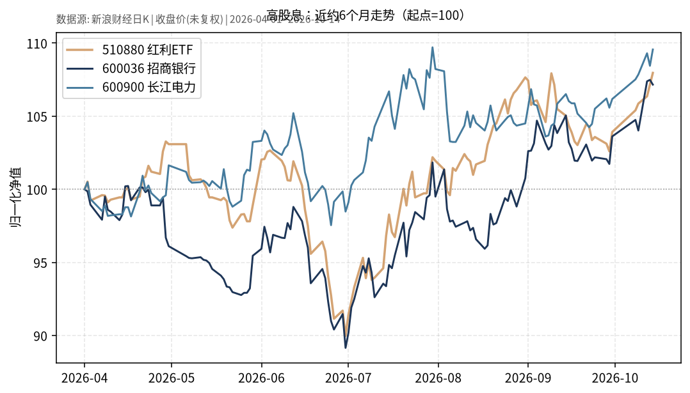

# 高股息日报 2026-10-15

> 日历日：2026-10-15（周四）。开盘前报告；行情与图表截至**上一交易日 2026-10-14**。股价序列为新浪日 K **未复权收盘价**（除权除息日会出现跳空，与复权口径不可直接混比）。

## 市场状态

红利 ETF（510880）与样本股招商银行（600036）、长江电力（600900）在近约 6 个月窗口内整体上行。上一交易日（10-14）：510880、600900 上涨，600036 小幅下跌。

## 关键数据

| 标的 | 数据日 | 收盘 | 较前一交易日 | 窗口起点→终点涨跌（未复权价） |
|------|--------|------|--------------|-------------------------------|
| 510880 红利 ETF | 2026-10-14 | 3.499 | **+0.75%**（前收 3.473） | 2026-04-01→10-14：**约 +7.96%** |
| 600036 招商银行 | 2026-10-14 | 42.67 | **-0.30%**（前收 42.80） | 2026-04-01→10-14：**约 +7.16%** |
| 600900 长江电力 | 2026-10-14 | 29.45 | **+1.03%**（前收 29.15） | 2026-04-01→10-14：**约 +9.56%** |

## 简要解读

- 近半年归一化路径上，三者大体同向，但阶段性分化明显（银行股与公用事业/红利篮子对利率、信用与风险偏好的敏感度不同）。
- 10-14 单日：长江电力领涨样本；招行小幅回调；红利 ETF 收涨约 0.75%。
- **未复权**口径下的区间涨跌未计入现金分红再投资；若关注「含息总回报」，需另看复权或分红再投资序列。

## 关注点与风险

- **权益波动**：高股息板块仍是股票风险，回撤可能远大于中短债/国债 ETF。
- **分红与估值**：股价与股息率、盈利预期、利率环境相关；股息率会随价格与分红方案变化。
- **口径提醒**：图表与表格均为未复权收盘价路径；与历史「复权年化」讨论不可直接等同。

## 来源与时间

- 新浪财经日 K：510880、600036、600900（未复权收盘）
- 图表区间：2026-04-01 → 2026-10-14
- 整理时间：2026-10-15 约 05:30–06:00 Asia/Shanghai
