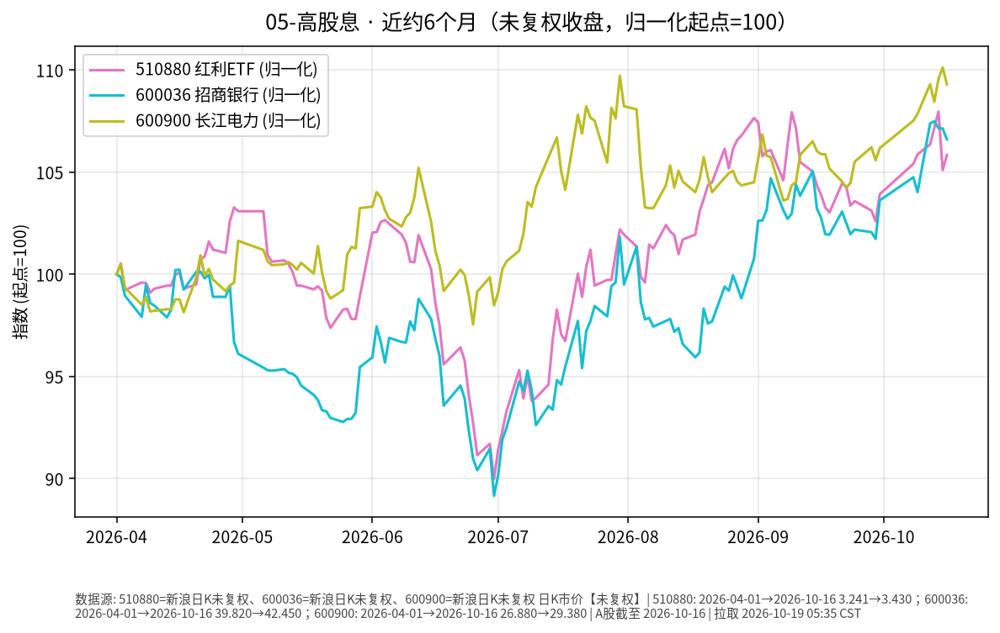

# 高股息日报 2026-10-19

> 日历日：2026-10-19（周一）。开盘前报告；行情与图表截至**上一交易日 2026-10-16**（新浪交易日历；10-17 不在交易日列表）。股价序列为新浪日 K **未复权收盘价**（除权除息日会出现跳空，与复权口径不可直接混比）。

## 市场状态

红利 ETF（510880）与样本股招商银行（600036）、长江电力（600900）在近约 6 个月窗口内整体上行。上一交易日（10-16）：510880 收涨，招行与长电均小幅回落。

## 关键数据

| 标的 | 数据日 | 收盘 | 较前一交易日 | 窗口起点→终点涨跌（未复权价） |
|------|--------|------|--------------|-------------------------------|
| 510880 红利 ETF | 2026-10-16 | 3.430 | **+0.70%**（前收 3.406） | 2026-04-01→10-16：**约 +5.83%** |
| 600036 招商银行 | 2026-10-16 | 42.45 | **-0.49%**（前收 42.66） | 2026-04-01→10-16：**约 +6.60%** |
| 600900 长江电力 | 2026-10-16 | 29.38 | **-0.74%**（前收 29.60） | 2026-04-01→10-16：**约 +9.30%** |

## 简要解读

- 近半年归一化路径上，三者大体同向，但阶段性分化明显（银行股与公用事业/红利篮子对利率、信用与风险偏好的敏感度不同）。
- 10-16 单日：红利 ETF 未复权收盘上涨约 0.7%；招行回落约 0.5%；长江电力回落约 0.7%。ETF 与样本股单日幅度不必一致（权重、其他成分与交易机制差异）。
- **未复权**口径下的区间涨跌未计入现金分红再投资；若关注「含息总回报」，需另看复权或分红再投资序列。

## 关注点与风险

- **权益波动**：高股息板块仍是股票风险，回撤可能远大于中短债/国债 ETF。
- **分红与估值**：股价与股息率、盈利预期、利率环境相关；股息率会随价格与分红方案变化。
- **口径提醒**：图表与表格均为未复权收盘价路径；与历史「复权年化」讨论不可直接等同。

## 来源与时间

- 新浪财经日 K：510880、600036、600900（未复权收盘）
- 图表区间：2026-04-01 → 2026-10-16
- 整理时间：2026-10-19 约 05:30–06:00 Asia/Shanghai
