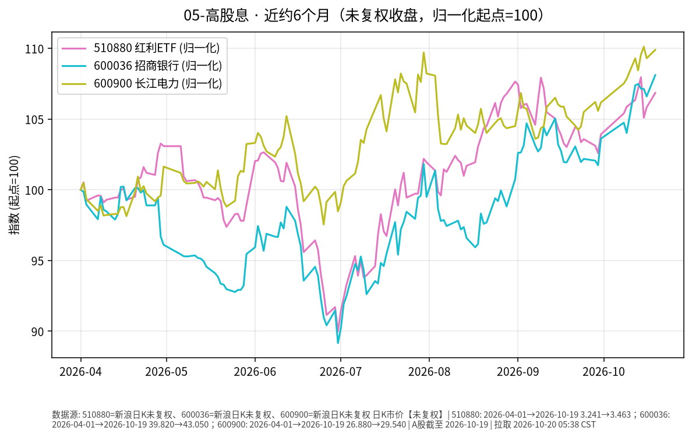

# 高股息日报 2026-10-20

> 日历日：2026-10-20（周二）。开盘前报告；上一交易日为 **2026-10-19**。行情与图表截至该日。**本篇价格口径为未复权收盘价**（不含现金分红再投入），与复权总回报不可直接等同。

## 市场状态

红利 ETF 与样本个股（招行、长电）近约 6 个月未复权收盘价整体上行。上一交易日（10-19）三者均上涨，招行涨幅相对更大。

## 关键数据（未复权收盘）

| 标的 | 数据日 | 收盘 | 较前一交易日 | 窗口起点→终点涨跌 |
|------|--------|------|--------------|-------------------|
| 510880（红利 ETF） | 2026-10-19 | 3.463 | **+0.96%**（前收 3.430） | 2026-04-01→10-19：**约 +6.85%** |
| 600036 招商银行 | 2026-10-19 | 43.05 | **+1.41%**（前收 42.45） | 2026-04-01→10-19：**约 +8.11%** |
| 600900 长江电力 | 2026-10-19 | 29.54 | **+0.54%**（前收 29.38） | 2026-04-01→10-19：**约 +9.90%** |

图表归一化起点=100；序列为未复权收盘价。

## 简要解读

- 近半年未复权收盘价整体仍上行；长电窗口涨幅相对更大。
- 10-19：510880 上涨约 0.96%，招行约 +1.41%，长电约 +0.54%。
- 若关心含息总回报，需另看复权或总分红外口径；本报告按既定模板只报未复权市价路径。

## 关注点与风险

- **未复权口径**：除息日后未复权价格会跳空下行，不等于投资者「亏了分红」。
- **板块与个股**：银行、公用事业等高股息板块仍受利率预期、政策与基本面影响，波动可显著大于债券 ETF。
- **数据口径**：新浪日 K 未复权收盘价。

## 来源与时间

- 新浪财经日 K：510880、600036、600900（未复权）
- 图表区间：2026-04-01 → 2026-10-19
- 整理时间：2026-10-20 约 05:30–06:00 Asia/Shanghai
