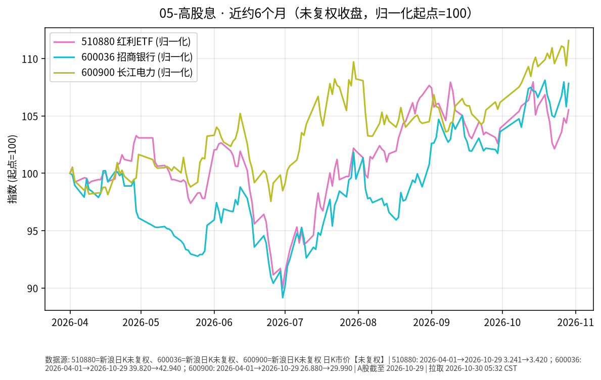

# 高股息 · 日报 2026-10-30

## 市场状态
- **报告日**：2026-10-30；**数据截止交易日**：**2026-10-29**。
- 红利 ETF 510880 收 **3.420**（**+1.09%**）。
- 招商银行 600036 收 **42.94**（**+1.92%**）；长江电力 600900 收 **29.99**（**+2.01%**）。
- 红利 ETF、招行、长电同日均上行；分红与价格涨跌是两回事（股息率随股价变动）。
- **价格口径**：本页序列为交易所日 K **未复权**收盘（新浪）。

## 关键数据
| 标的 | 收盘日 | 收盘 | 日涨跌 | 约6个月 | 区间涨跌 |
|------|--------|------|--------|---------|----------|
| 510880 红利ETF | 2026-10-29 | 3.420 | +1.09% | 2026-04-29→2026-10-29 | +2.18% |
| 600036 招商银行 | 2026-10-29 | 42.94 | +1.92% | 2026-04-29→2026-10-29 | +11.53% |
| 600900 长江电力 | 2026-10-29 | 29.99 | +2.01% | 2026-04-29→2026-10-29 | +12.03% |

## 简要解读
- 近半年归一（未复权）：510880 约 **+2.18%**，招行约 **+11.53%**，长电约 **+12.03%**（个股路径强于宽基红利 ETF，不代表未来）。
- 2026-10-29 三者均上行，属已发生的价格事实。

## 关注点与风险
- 银行与公用事业对利率、监管、来水/电价等基本面敏感；高股息不保证本金稳定。
- 510880 成分与权重定期调整；个股与 ETF 走势可显著偏离。
- 未复权序列在除权除息日会出现跳空，与前复权路径不一致属正常。

## 来源与时间
- 510880 / 600036 / 600900：新浪 CN_MarketData K 线（未复权）
- 截止 2026-10-29；图表 matplotlib，起点=100
