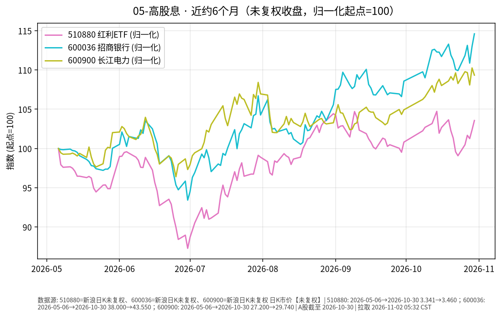

# 高股息 · 日报 2026-11-02

## 市场状态
- **报告日**：2026-11-02；**数据截止交易日**：**2026-10-30**（10-31 非 A 股交易日）。
- 红利 ETF 510880 收 **3.460**（**+1.17%**）。
- 招商银行 600036 收 **43.55**（**+1.42%**）；长江电力 600900 收 **29.74**（**-0.83%**）。
- 红利 ETF、招行上行，长电下行；分红与价格涨跌是两回事（股息率随股价变动）。
- **价格口径**：本页序列为交易所日 K **未复权**收盘（新浪）。

## 关键数据
| 标的 | 收盘日 | 收盘 | 日涨跌 | 约6个月 | 区间涨跌 |
|------|--------|------|--------|---------|----------|
| 510880 红利ETF | 2026-10-30 | 3.460 | +1.17% | 2026-05-06→2026-10-30 | +3.56% |
| 600036 招商银行 | 2026-10-30 | 43.55 | +1.42% | 2026-05-06→2026-10-30 | +14.61% |
| 600900 长江电力 | 2026-10-30 | 29.74 | -0.83% | 2026-05-06→2026-10-30 | +9.34% |

## 简要解读
- 近半年归一（未复权）：510880 约 **+3.56%**，招行约 **+14.61%**，长电约 **+9.34%**（个股路径强于宽基红利 ETF，不代表未来）。
- 2026-10-30 红利与招行上行、长电回落，属已发生的价格事实。

## 关注点与风险
- 银行与公用事业对利率、监管、来水/电价等基本面敏感；高股息不保证本金稳定。
- 510880 成分与权重定期调整；个股与 ETF 走势可显著偏离。
- 未复权序列在除权除息日会出现跳空，与前复权路径不一致属正常。

## 来源与时间
- 510880 / 600036 / 600900：新浪 CN_MarketData K 线（未复权）
- 截止 2026-10-30；图表 matplotlib，起点=100；图注写明未复权
