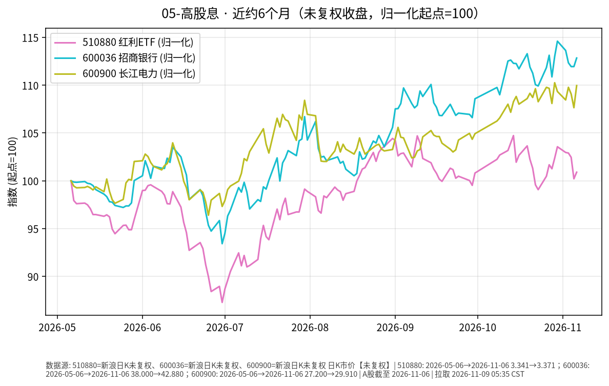

# 高股息 · 日报 2026-11-09

## 市场状态
- **报告日**：2026-11-09（周一盘前）；**数据截止交易日**：**2026-11-06**。周末休市，今日尚未开盘；本页数字不含周一盘中。
- 红利 ETF 510880 收 **3.371**（**+0.69%**）。
- 招商银行 600036 收 **42.88**（**+0.80%**）；长江电力 600900 收 **29.91**（**+2.15%**）。
- 510880、招行与长电同日上行；分红与价格涨跌是两回事（股息率随股价变动）。
- **价格口径**：本页序列为交易所日 K **未复权**收盘（新浪）。

## 关键数据
| 标的 | 收盘日 | 收盘 | 日涨跌 | 约6个月 | 区间涨跌 |
|------|--------|------|--------|---------|----------|
| 510880 红利ETF | 2026-11-06 | 3.371 | +0.69% | 2026-05-06→2026-11-06 | +0.90% |
| 600036 招商银行 | 2026-11-06 | 42.88 | +0.80% | 2026-05-06→2026-11-06 | +12.84% |
| 600900 长江电力 | 2026-11-06 | 29.91 | +2.15% | 2026-05-06→2026-11-06 | +9.96% |

## 简要解读
- 近半年归一（未复权）：510880 约 **+0.90%**，招行约 **+12.84%**，长电约 **+9.96%**（个股路径强于宽基红利 ETF，不代表未来）。
- 2026-11-06：510880 **+0.69%**、招行 **+0.80%**、长电 **+2.15%**，属已发生的价格事实。

## 关注点与风险
- 银行与公用事业对利率、监管、来水/电价等基本面敏感；高股息不保证本金稳定。
- 510880 成分与权重定期调整；个股与 ETF 走势可显著偏离。
- 未复权序列在除权除息日会出现跳空，与前复权路径不一致属正常。

## 来源与时间
- 510880 / 600036 / 600900：新浪 CN_MarketData K 线（未复权）
- 截止 2026-11-06；图表 matplotlib，起点=100；图注写明未复权；拉取约 2026-11-09 05:35:44 CST

## 今日一点
# 今日一点 · Day 11/100 · 《单位净值、估值日、T+N》

**结论：** 看债基或货基，单位净值是「每一份今天值多少」；按哪天成交、钱何时能用，取决于估值日和 T+N，屏幕数字不是落袋现金。

**机制：** 基金公司在每个交易日收盘后算出当天单位净值，这一天就是估值日；你在规定时点前申购或赎回，才锁定哪天净值。货基常见当日或次日可用，债基赎回多为 T+1 或 T+2 到账；ETF 场内买卖即时成交，和场外申赎不是同一条路径。债底仓票息清晰，要先分清净值更新日和资金可用日——应急金不该压在尚未到账的份额上；以后若划拨股票卫星，A 股卖出也有 T+1 交收，节奏要和动用年限对上。今天只讲结算节奏，不定买卖。
